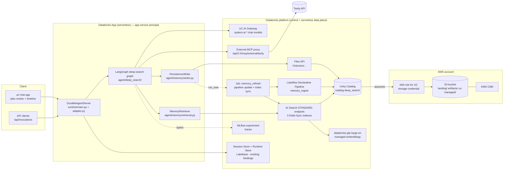
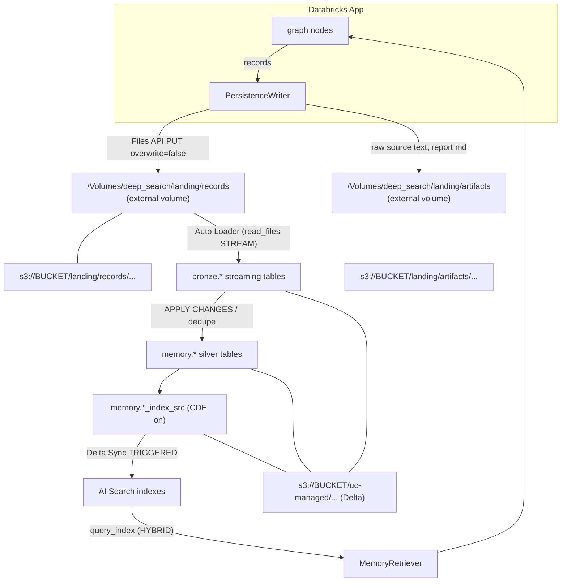
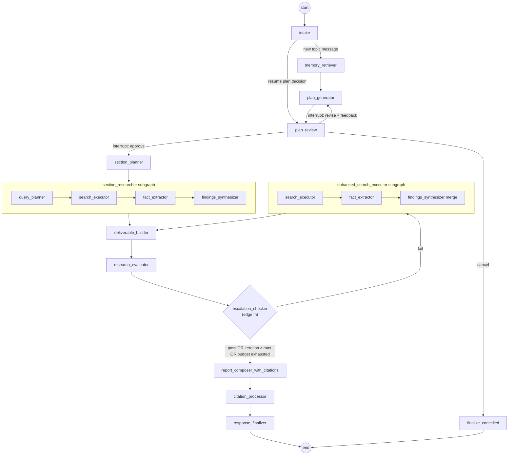
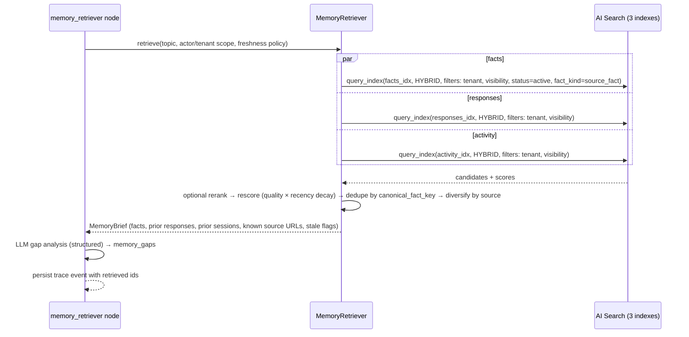
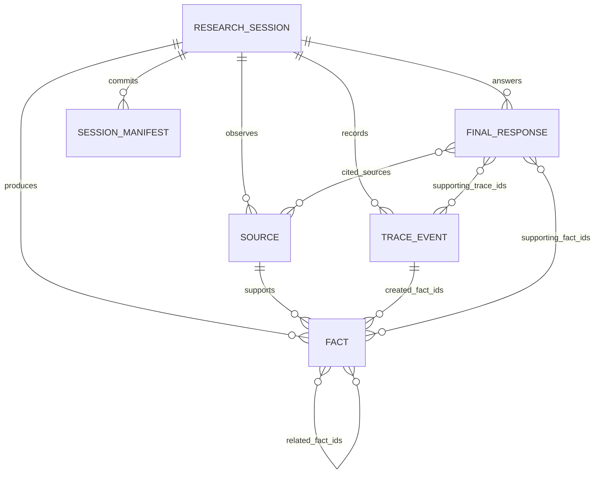

# Deep Search on Databricks + AWS — Migration Plan

| | |
|---|---|
| Source recipe | `google/adk-recipes` → `core/python/deep-search`, commit `a93b9cc9ce916f748e853dc1bb8c437d03123e8b` (2026-11-09) |
| Target repository | `AnaPrec07/porygon-agent-db-deep-search` (LangGraph template on `databricks_agentkit.DurableAgentServer`, `databricks-agentbricks` 0.8.0) |
| Document status | Approved-for-implementation blueprint. Planning only; nothing in either repository was changed. |
| Date | 2026-11-10 |

How to read this document: sections A–L justify the design. **Section M is the handoff** — an implementation agent can start there and follow links back. Every statement tagged **[V]** was verified against official documentation or installed SDK source during planning; **[A]** marks an assumption that Phase 0 must verify before dependent work starts.

---

## A. Executive Summary

The ADK recipe is a two-phase research agent: a human-in-the-loop (HITL) planner that drafts and refines a tagged research plan, followed by an autonomous pipeline (outline → first-pass research → bounded critique/refine loop → cited report). It has **no persistence beyond the ADK session**, and its two hardest dependencies are Gemini-only: the built-in `google_search` tool and the **grounding metadata** that the citation system is built on.

**Recommended architecture**

1. **Orchestration:** re-implement the agent graph as an explicit **LangGraph `StateGraph`** inside this repo's existing `DurableAgentServer` runtime (`agent/` + `runtime/`). Each ADK agent becomes a named node with the same name (the names are the UI contract). Plan approval becomes a **native LangGraph `interrupt()`**, which the runtime already checkpoints and resumes via `input.resume`.
2. **LLM inference:** Databricks **Unity Catalog AI Gateway** model services (`system.ai.*`) through `ChatDatabricks(use_ai_gateway=True)` — the same path the template already uses — with separate `worker`, `critic` and `extraction` model settings.
3. **Web search:** replace `google_search` with a `SearchProvider` interface whose production implementation is **Tavily exposed as a Databricks external MCP server** behind a Unity Catalog connection (no API key in the app). Search is executed **deterministically by graph code**, not by a free-roaming tool-calling loop, so every result is captured for provenance.
4. **Citations without Gemini grounding:** build an explicit **source registry** from search/extract results, and a **fact extraction** step that requires a verbatim supporting quote that is verified against the fetched source text. The composer keeps the original `<cite source="src-N"/>` tag protocol; a deterministic post-processor validates and rewrites tags.
5. **Durable memory on S3:** the app writes immutable, schema-versioned **JSONL/JSON records** to a **Unity Catalog external volume backed by an S3 bucket**, via the Databricks Files API with create-only (`overwrite=false`) semantics. This gives S3 durability **without any AWS credentials in the app** — the app's Databricks service principal is authorized by Unity Catalog `WRITE VOLUME`, and Unity Catalog reaches S3 through a storage credential (IAM role).
6. **Analytics + retrieval:** a **Lakeflow Declarative Pipeline** (Auto Loader / `read_files`) incrementally ingests the landing files into **Unity Catalog Delta tables whose data also lives in the same S3 bucket** (catalog managed location). Curated "index source" tables (Change Data Feed on) feed three **Databricks AI Search Delta Sync indexes** (facts, research activity summaries, responses) on one STANDARD endpoint with Databricks-managed embeddings (`databricks-gte-large-en`, 1024-d) and **hybrid** queries.
7. **Memory in the workflow:** a new `memory_retriever` node runs before planning; historical evidence enters the plan and the critic as *context*, and can only be cited after passing freshness/quality gates and being registered as a source with `origin=memory`.
8. **Observability:** keep MLflow tracing (already wired by `configure_tracing()`/`start_trace()`), and **independently persist** observable execution events to S3 with a reference to the MLflow trace ID. MLflow traces are referenced, not exported.
9. **Infrastructure as code:** AWS (bucket, KMS key, IAM role) and Unity Catalog storage objects in Terraform; pipeline, job, schemas and volumes in a Databricks Asset Bundle under `platform/`; AI Search endpoint and indexes created by an idempotent bootstrap script (SDK). The app itself keeps deploying with `agentbricks deploy`.

**What changes vs. the original, deliberately**

| Area | Original | Target | Why |
|---|---|---|---|
| Research execution | One LLM agent with `google_search`, told to run 4–5 queries per goal | Query planning (LLM) → parallel search (code) → extraction (LLM) → synthesis (LLM) | Deterministic coverage, bounded cost, full provenance capture, testable |
| Citations | Gemini `grounding_metadata` (provider-generated supports + confidences) | Explicit source registry + verified-quote facts | Grounding metadata does not exist outside Gemini; verified quotes are stronger provenance |
| HITL | Root LLM agent judges "explicit approval" from chat text | `interrupt()` with typed decisions (`approve`/`revise`/`cancel`) plus free-text feedback | Durable across worker loss; no LLM misjudging approval |
| Thinking | `BuiltInPlanner(include_thoughts=True)` | No private reasoning persisted; nodes emit concise `decision_summary` fields | Requirement: observable traces, not chain-of-thought |
| Memory | None (ADK session state only) | S3 → Delta → AI Search, three record families | New capability |
| Frontend | Separate React/Vite app keyed off ADK SSE `author` | Existing zero-build `ui/` extended with plan-review and research timeline | Single deployable on Databricks Apps; the React app is coupled to ADK's `/run_sse` contract |

---

## B. Original Repository Assessment

### B.1 Inventory

| File | Role |
|---|---|
| `app/agent.py` (~430 lines) | Entire agent graph, prompts, structured output models, callbacks, loop control |
| `app/config.py` | `.env` load; AI Studio vs Vertex auth switch; `ResearchConfiguration(critic_model, worker_model = $MODEL_NAME, max_search_iterations = 5)` |
| `app/__init__.py` | Vertex env bootstrap (`google.auth.default()`), then imports `root_agent` (agent reads env at import time) |
| `frontend/` | React + Vite + Tailwind + shadcn. `App.tsx` (656 lines) consumes ADK `/api/run_sse`, creates sessions at `/api/apps/app/users/u_999/sessions/{id}`, routes events by `author` |
| `tests/test_runnability.py` | Only test: smoke import with `google.auth.default` patched |
| `Makefile` | `install`, `dev` (ADK `api_server` :8000 + Vite :5173), `playground` (`adk web`), `lint` |
| `pyproject.toml` | `google-adk>=2.9,<3`, `python-dotenv`; dev: pytest, agent-starter-pack |
| `.env.example`, `manifest.yaml`, `README.md`, `AGENTS.md` | Config/docs. Manifest: multi-agent, `stateful: false`, datasources `external` |

There is **no eval, no datastore, no ingestion, no IaC**. Deployment is via the separate `google-agents-cli` to Cloud Run or Agent Runtime with IAP.

### B.2 Components and responsibilities

| Component | ADK type | Model | Tools | Reads state | Writes state | Notes |
|---|---|---|---|---|---|---|
| `interactive_planner_agent` (root) | `LlmAgent` | worker | `AgentTool(plan_generator)`; sub-agent `research_pipeline` | conversation | `research_plan` (output_key) | Never answers directly; drafts via `plan_generator`; transfers to `research_pipeline` on *explicit* approval (LLM judgement) |
| `plan_generator` | `LlmAgent` (as tool) | worker | `google_search` (disambiguation only) | `research_plan?` | (tool result) | 5 `[RESEARCH]` goals + `[DELIVERABLE][IMPLIED]`; refinement tags `[MODIFIED]`, `[NEW]`; injects current date |
| `research_pipeline` | `SequentialAgent` | — | — | — | — | section_planner → section_researcher → loop → composer |
| `section_planner` | `LlmAgent` | worker | — | `research_plan` | `report_sections` | 4–6 section markdown outline; no References section |
| `section_researcher` | `LlmAgent` + `BuiltInPlanner(include_thoughts)` | worker | `google_search` | `research_plan` | `section_research_findings` | Phase 1: 4–5 queries per `[RESEARCH]` goal + summary; Phase 2: produce each `[DELIVERABLE]` from summaries only. After-callback collects sources |
| `iterative_refinement_loop` | `LoopAgent(max_iterations=5)` | — | — | — | — | evaluator → escalation_checker → enhanced_search_executor |
| `research_evaluator` | `LlmAgent`, `output_schema=Feedback` | critic | none (schema forbids tools) | `section_research_findings` | `research_evaluation` | `grade: pass|fail`, `comment`, `follow_up_queries[5–7]`; told not to question the topic premise |
| `escalation_checker` | custom `BaseAgent` | — | — | `research_evaluation` | — | Emits `escalate=True` on `pass` to exit loop |
| `enhanced_search_executor` | `LlmAgent` + thinking | worker | `google_search` | `research_evaluation`, `section_research_findings` | `section_research_findings` (overwrite with merged) | Runs every follow-up query, merges |
| `report_composer_with_citations` | `LlmAgent`, `include_contents="none"` | critic | — | `research_plan`, `section_research_findings`, `sources`, `report_sections` | `final_cited_report` | Emits `<cite source="src-N" />`; after-callback rewrites |
| `collect_research_sources_callback` | after-agent callback | — | — | all `session.events` grounding metadata | `sources`, `url_to_short_id` | Assigns `src-N` per new URL; records `supported_claims` (segment text + confidence from `grounding_supports`) |
| `citation_replacement_callback` | after-agent callback | — | — | `final_cited_report`, `sources` | `final_report_with_citations` | Regex rewrite to ` [title](url)`, drops unknown ids, fixes punctuation spacing |

### B.3 How research is initiated and executed

1. Any user message reaches the root agent, which must call `plan_generator` (never answers directly).
2. The plan is shown; the user iterates in chat; `research_plan` is overwritten each turn (root `output_key`).
3. On explicit approval the root LLM transfers control to `research_pipeline` (an LLM decision — a weak point: approval detection is probabilistic).
4. The pipeline runs sequentially; the loop runs ≤5 times; the composer writes the report.

### B.4 How additional research is determined

Only by the critic (`research_evaluator`): an LLM judgement of comprehensiveness/depth/credibility with **no structured coverage model** (no per-goal accounting, no source counts). On `fail` it proposes 5–7 queries; the executor runs them all and rewrites the whole findings blob. Termination: `pass` or iteration cap.

### B.5 Agent/tool interaction

- State keys are the data bus (`output_key` + `{key}` template injection).
- `AgentTool` wraps `plan_generator` so the root keeps control; `sub_agents` enables transfer to the pipeline.
- `google_search` is a Gemini built-in grounding tool, not a function the code sees; results surface **only** as `grounding_metadata` on events. This is why the citation system is callback-based over `session.events`.

### B.6 Intermediate information

Held entirely in ADK session state (in-memory unless an ADK session service is configured): `research_plan`, `report_sections`, `section_research_findings` (a single free-text blob, rewritten each iteration), `research_evaluation`, `sources`, `url_to_short_id`, `final_cited_report`, `final_report_with_citations`. Search result content is never stored; only URL/title/domain and grounded segments.

### B.7 Final response generation

Composer gets plan, findings, sources dict and outline, emits tagged markdown; callback converts tags to inline links. No references section, no validation that a cited source actually supports the adjacent claim (only that the id exists).

### B.8 Google-specific dependencies to replace

| Dependency | Where | Replacement |
|---|---|---|
| `google-adk` (`LlmAgent`, `SequentialAgent`, `LoopAgent`, `BaseAgent`, `AgentTool`, `App`, callbacks, events) | `agent.py` | LangGraph `StateGraph`, nodes, conditional edges, `interrupt()` |
| `google_search` built-in tool | plan_generator, section_researcher, enhanced_search_executor | `SearchProvider` → Tavily via Databricks external MCP |
| Gemini grounding metadata (`grounding_chunks`, `grounding_supports`, confidence) | `collect_research_sources_callback` | Source registry + verified-quote fact extraction |
| `BuiltInPlanner(ThinkingConfig(include_thoughts=True))` | researcher, executor | Removed; structured `decision_summary` outputs |
| `google.genai.types` (`Content`, `Part`) | callback return | LangChain messages |
| Gemini models via AI Studio / Vertex (`MODEL_NAME`) | config | AI Gateway `system.ai.*` model services |
| `google.auth.default()` / ADC, `GOOGLE_*` env | `__init__.py`, `config.py` | Databricks unified auth (app service principal), `configure()` in runtime |
| ADK `api_server` / `/run_sse` protocol, ADK web | Makefile, frontend | `DurableAgentServer` `/api/invocations` + emitted events |
| Cloud Run / Agent Runtime + IAP via google-agents-cli | README | Databricks Apps via `agentbricks deploy` (workspace SSO) |

### B.9 Behaviors that must be preserved

P1. Plan-first: every new request produces a plan; nothing is researched before explicit approval.
P2. Plan format: 5 initial `[RESEARCH]` goals with action verbs; `[DELIVERABLE][IMPLIED]` added when implied; refinement tags `[MODIFIED]`, `[NEW]`; order preserved; length flexible after refinement.
P3. Plan generator may search **only** for disambiguation.
P4. Outline of 4–6 non-overlapping sections, no References section.
P5. Research phase processes every `[RESEARCH]` goal with multiple angles, then produces every `[DELIVERABLE]` **without new searches**.
P6. Critic grades `pass`/`fail` with comment and targeted follow-up queries; does not question topic premise; current date injected.
P7. Loop terminates on `pass` or after `max_search_iterations` (default 5).
P8. Follow-up findings are **merged** with, not replacing, prior findings.
P9. Report follows the outline exactly, inline citations only, invalid citations dropped (never rendered as broken links).
P10. Streaming progress the UI can label per agent name (`plan_generator`, `section_planner`, `section_researcher`, `research_evaluator`, `enhanced_search_executor`, `report_composer_with_citations`, `interactive_planner_agent`) and a website counter.
P11. Model and iteration cap configurable without code edits.

### B.10 What can be simplified or redesigned

- **Approval detection**: LLM transfer → typed interrupt (more reliable, durable).
- **Researcher as one mega-prompt**: split into query planning, code-driven search, extraction, synthesis. Same capability, bounded and observable.
- **Findings as one blob rewritten each iteration**: replace with structured per-goal findings + fact list; render the blob for prompts. Removes the risk that the executor's rewrite silently drops earlier findings (P8 becomes a code guarantee).
- **Critic without coverage model**: add deterministic coverage signals (facts and distinct sources per goal) to the critic input and to the stop rule.
- **Two model settings reading one env var**: three explicit settings.
- **React frontend**: not migrated; the existing `ui/` chat is extended (see ADR-14).
- **`escalation_checker` agent**: becomes a conditional edge function (no agent needed).

---

## C. Target Architecture

### C.1 Component diagram



### C.2 AWS / Databricks service boundaries

| Concern | Owner | Service | Identity used |
|---|---|---|---|
| Durable object storage (landing records, artifacts, Delta files) | **AWS** | S3 bucket, SSE-KMS | UC storage credential → IAM role (assumed by Databricks UC) |
| Encryption keys | **AWS** | KMS customer-managed key | IAM role key policy grant |
| Infrastructure IAM | **AWS** | IAM role + trust policy (Databricks UC principal + external ID) | — |
| Governance / authorization of data | **Databricks** | Unity Catalog (catalog, schemas, volumes, tables, external location, storage credential, connection) | UC grants to app SP, pipeline/job identity, humans |
| Agent hosting | **Databricks** | Databricks Apps (`agentbricks deploy`) | App service principal (auto-created) |
| LLM inference | **Databricks** | UC AI Gateway model services `system.ai.*` | App SP |
| Web search | External (Tavily) via **Databricks** | External MCP server + UC HTTP connection (bearer stored in connection) | App SP needs `USE CONNECTION` |
| Ingestion / ETL | **Databricks** | Lakeflow Declarative Pipelines (serverless), Jobs | Job run-as service principal |
| Semantic retrieval | **Databricks** | AI Search endpoint + Delta Sync indexes | App SP: `SELECT` on indexes |
| Embeddings | **Databricks** | Foundation Model API `databricks-gte-large-en` (managed by index) | Index pipeline |
| Conversation checkpoints / invocation durability | **Databricks** | Agent Bricks Session Store / Runtime Store (Lakebase) — unchanged | App SP |
| Tracing | **Databricks** | MLflow experiment (existing `[tracing]` binding) | App SP |

No component in the agent path holds AWS credentials. AWS is touched only by Unity Catalog through the storage credential.

### C.3 Data flow



### C.4 Research execution flow (graph)



Node names `plan_generator`, `section_planner`, `section_researcher`, `research_evaluator`, `enhanced_search_executor`, `report_composer_with_citations` are kept verbatim (P10). `interactive_planner_agent` is the label the UI uses for planner chat messages; it is emitted as the `agent_name` of the `plan_review` interrupt and its messages.

Note on `deliverable_builder`: the original produced `[DELIVERABLE]` artifacts inside the researcher and the executor regenerated everything. Here deliverables are rebuilt from the merged findings after every research pass so the critic always evaluates the complete package (P5 preserved: no searches in this node).

### C.5 Memory persistence flow

```mermaid
sequenceDiagram
  participant N as Graph node
  participant R as TraceRecorder
  participant W as PersistenceWriter
  participant F as Files API (UC volume)
  participant J as memory_refresh job
  N->>R: event(node_started)
  N->>R: event(tool_invocation, redacted args)
  N->>R: facts(extracted batch)
  R->>W: enqueue(records)
  Note over W: buffer per (record_type, node, step)
  N-->>W: node boundary → flush() (awaited)
  W->>F: PUT records/<type>/.../part-<deterministic>.jsonl overwrite=false
  F-->>W: 200 / 409 already exists (treated as success if hash matches)
  Note over N,W: critical records (session_started, final_response, manifest) are written synchronously before the node returns
  N->>W: response_finalizer: final_response + manifest(committed)
  W->>J: jobs.run_now (debounced; failures logged, not raised)
  J->>J: pipeline update → sync_index × 3
```

### C.6 Retrieval flow



---

## D. Architecture Decision Records

Each ADR: Decision · Context · Options · Recommendation · Rationale · Tradeoffs · Risks · Constraints · Verify.

### ADR-01 Agent framework and orchestration
- **Decision:** Explicit LangGraph `StateGraph` (not `langchain.agents.create_agent`), built in `agent/deep_search/graph.py`, compiled with the agentkit `checkpointer()` and run through the existing `run_agent`/adapter path.
- **Context:** The repo is a LangGraph template on `DurableAgentServer`; `AGENTKIT_CONTRACT.md` requires `checkpointer()`, `thread_config()`, `start_trace()`, sync durability, recovery hooks. The original is a fixed workflow, not an open-ended ReAct agent.
- **Options:** (a) explicit StateGraph; (b) `create_agent` ReAct with sub-agents as tools; (c) keep ADK and host it on Databricks Apps; (d) OpenAI Agents SDK (agentkit has an `openai` adapter).
- **Recommendation:** (a).
- **Rationale:** Deterministic workflow maps 1:1 to nodes/edges; `interrupt()` is natively durable in this runtime; the runtime contract, recovery and UI are already LangGraph-shaped. (c) would keep Gemini-specific grounding coupling and lose agentkit integration. (b) re-creates the original's weakest part (LLM-decided control flow).
- **Tradeoffs:** More code than a prompt-driven agent; must write custom adapter mappings for custom state (the contract explicitly requires this for custom state/interrupts).
- **Risks:** Adapter currently assumes `messages` state. Mitigation in Phase 2: custom event mapping.
- **Constraints:** Graph state must be serializable by the Session Store saver (contract). Keep large blobs (raw source text) **out of state** — store references (artifact path + sha256) instead.
- **Verify [A]:** `interrupt()` payloads with custom dict values round-trip through Session Store and `checkpointed_messages` recovery (Phase 0 spike).

### ADR-02 LLM inference
- **Decision:** `ChatDatabricks(endpoint=<system.ai.* service>, use_ai_gateway=True)` via the template's `_RoutedChatDatabricks`, with three settings: `DEEP_SEARCH_WORKER_MODEL`, `DEEP_SEARCH_CRITIC_MODEL`, `DEEP_SEARCH_EXTRACTION_MODEL`; the invocation `model` override (UI picker) overrides **worker** only.
- **Options:** AI Gateway model services; classic `/serving-endpoints` pay-per-token; provisioned throughput; external model endpoints (e.g. Gemini through AI Gateway).
- **Rationale:** Same path the template uses and governs (UC permissions, usage tracking). Separate extraction model lets the high-volume step use a cheaper model.
- **Constraints:** Worker and critic models must support tool calling **and** structured output (`with_structured_output(..., method="json_schema")` or function calling). The default template model `system.ai.meta-llama-3-1-8b-instruct` is too weak for this workflow and must not be the default.
- **Tradeoffs:** Model availability differs by region/workspace.
- **Verify [A]:** Phase 0 lists `system.ai` model services (`GET /api/2.1/unity-catalog/model-services?parent=schemas/system.ai`, already used by `runtime/ui.py`) and picks: a frontier model for worker+critic, a smaller fast model for extraction. Record chosen names in `app.yaml` env and `docs/platform-verification.md`. Structured-output support per chosen model must be confirmed by a live call.

### ADR-03 Research tools (web search & content)
- **Decision:** `SearchProvider` protocol with `search(query, *, max_results, recency_days) -> list[SearchHit]` and `extract(urls) -> list[ExtractedPage]`. Production impl `TavilyMcpProvider` calls the Tavily MCP tools through the Databricks external MCP proxy `https://<host>/api/2.0/mcp/external/<connection>` [V]. Fallback impl `TavilyHttpProvider` (direct REST with key from a Databricks secret app resource) behind config. `FakeSearchProvider` for tests.
- **Options:** Tavily via external MCP (Marketplace listing exists [V]); Tavily/Brave/Exa/SerpAPI over HTTP with a secret; Gemini grounding via external model (keeps Google dependency); Databricks web search tool (not found in docs — not assumed).
- **Rationale:** UC connection keeps the credential out of the app and governs access (`USE CONNECTION`); MCP is already integrated in agentkit (`mcp_tools`). Tavily returns content snippets and has an extract tool, which supplies the text that fact verification needs.
- **Tradeoffs:** External MCP is Public Preview [V]; third-party dependency and egress; search quality differs from Google.
- **Constraints:** Tools are invoked by code, not offered to the LLM (except the plan_generator disambiguation case, where a single `web_search` tool is bound with `max_calls=2` enforced by the node).
- **Verify [A]:** exact Tavily MCP tool names and argument schemas (`list_tools()` in Phase 0); App outbound access to the proxy; rate limits; whether Databricks Apps egress allows the HTTP fallback.

### ADR-04 Persistent storage (system of record)
- **Decision:** Immutable record files in S3 written through a **UC external volume** with the Databricks Files API (`w.files.upload(path, data, overwrite=False)` — "If false, an error will be returned if the path points to an existing file" [V: databricks-sdk 0.162 `files.upload` docstring]). Landing files are the system of record; Delta tables are derived and rebuildable.
- **Options:**
  1. App → Files API → UC external volume → S3 (**chosen**).
  2. App → boto3 → S3 directly: requires AWS credentials or a role in the app. Databricks Apps have no instance profile; this would mean long-lived keys (prohibited) or unverified service-credential plumbing.
  3. App → Delta tables directly (SQL warehouse `INSERT` / Lakebase): low-latency but makes S3 objects an implementation detail of Delta, no immutable raw log, per-row SQL writes are slow/costly.
  4. App → Direct Vector Access index upserts: index is not a durable store.
- **Rationale:** No AWS secrets anywhere; UC grants (`WRITE VOLUME`) authorize the app; data lands in customer S3 under KMS; create-only semantics give idempotency; Auto Loader ingests volumes natively [V].
- **Tradeoffs:** Files API adds a Databricks hop (latency ~tens–hundreds of ms per PUT [A]); mitigated by micro-batching (≈20–80 files per research session).
- **Risks:** Files API throughput limits under many concurrent sessions [A — measure in Phase 9]. Fallback: per-node batching factor can be raised to per-session-phase.
- **Verify [A]:** Files API `overwrite=false` returns a distinguishable conflict status (409 `ALREADY_EXISTS` expected); app volume resource injects the path env var (`valueFrom`) [V for resource mechanism].

### ADR-05 S3 object layout and format
- **Decision:** Hive-style partitioned prefixes by record type and UTC date; **JSONL micro-batch files** for facts/events/sources-metadata, **single JSON** for sessions, responses and manifests; **raw artifacts** (`.txt.gz`, `.md`) in a separate volume. Parquet is produced only by Delta. Details in §F.
- **Options:** one object per record (JSON); JSONL batches; Parquet from the app; Avro.
- **Rationale:** JSONL is append-friendly, human-inspectable, schema-flexible, and Auto Loader-native. One-object-per-record creates small-file and request-cost problems; app-written Parquet needs pyarrow and buffering larger than one node step.
- **Tradeoffs:** JSON is larger than Parquet — irrelevant at this volume; compaction is Delta's job.

### ADR-06/07/08/09 Schemas
- **Decision:** Pydantic v2 models in `agent/memory/records.py` are the single source of truth; each record carries `schema_version` ("1.0") and `record_type`. Pipeline DDL mirrors them (contract test asserts equality). Full schemas in §E.

### ADR-10 Delta Lake integration
- **Decision:** Yes — UC **managed** Delta tables in catalog `deep_search` whose managed storage location is `s3://BUCKET/uc-managed/`, built by one Lakeflow Declarative Pipeline (serverless, triggered): `bronze` (raw, append-only streaming tables via `read_files ... STREAM`), `memory` (silver: deduped/versioned via `AUTO CDC`/`APPLY CHANGES`), index-source tables (CDF/row tracking enabled).
- **Options:** (a) pipeline (chosen); (b) external tables over landing JSON (no indexing support for AI Search Delta Sync? — Delta Sync needs a Delta table [V: source table must be Delta with CDF on standard endpoints]); (c) Lakebase tables.
- **Rationale:** AI Search Delta Sync requires UC Delta source tables; Delta gives analytics, time travel, governed SQL access, deletion support.
- **Constraints:** Never apply S3 lifecycle expiration to `uc-managed/` (corrupts tables); use `VACUUM`/predictive optimization.
- **Verify [A]:** `AUTO CDC` (formerly `APPLY CHANGES`) syntax in the workspace's pipeline runtime; catalog managed location on an S3 path inside the external location.

### ADR-11 AI Search indexes
- **Decision:** One **STANDARD** endpoint `deep-search-memory`; three **Delta Sync** indexes with **Databricks-managed embeddings**, `pipeline_type="TRIGGERED"`:
  - `deep_search.memory.facts_idx` ← `memory.facts_index_src` (PK `canonical_fact_key`)
  - `deep_search.memory.responses_idx` ← `memory.response_chunks_index_src` (PK `chunk_id`)
  - `deep_search.memory.activity_idx` ← `memory.activity_summaries_index_src` (PK `activity_id`)
- **Options:** STANDARD vs STORAGE_OPTIMIZED; TRIGGERED vs CONTINUOUS; managed vs self-managed embeddings; Direct Vector Access; one combined index vs three.
- **Rationale:** STANDARD supports incremental sync, dict filters, and is the only type with `target_qps` [V SDK quickstart]; storage-optimized rebuilds partially every sync and supports only triggered sync [V]. TRIGGERED keeps cost proportional to research activity; CONTINUOUS is unnecessary. Managed embeddings avoid an embedding step in the pipeline. Separate indexes keep schemas, filters and ranking per record family clean; cross-collection retrieval is done in the application (parallel queries + merge).
- **Tradeoffs:** Newly persisted memory is searchable after the refresh job completes (minutes), not instantly. Accepted: in-session retrieval uses graph state.
- **Constraints:** Column `_id` reserved [V]; source tables need CDF (standard endpoints) or row tracking [V]; serverless compute must be enabled [V].

### ADR-12 Embedding model
- **Decision:** `databricks-gte-large-en` (1024-d, 8192-token window [V]) as managed embedding endpoint for all three indexes.
- **Options:** `databricks-bge-large-en` (512-token window [V] — too short for response chunks), self-hosted/external embeddings (adds pipeline step), UC model service `system.ai.gte-large-en` via AI Gateway (requires `ai-gateway` scope [V]).
- **Tradeoffs:** English-centric; vectors not normalized [V] (irrelevant for managed similarity).
- **Verify [A]:** availability in workspace region; whether the current recommended name is `databricks-gte-large-en` or `system.ai.gte-large-en`.

### ADR-13 Retrieval strategy
- **Decision:** `query_type="HYBRID"` [V], `num_results` 20 per index, metadata filters (tenant, visibility, status, fact_kind, recency), optional Databricks reranker on facts (`columns_to_rerank=["fact_text"]`) [V SDK], then application rescoring and dedupe (§G.5). Queries via **databricks-sdk `w.vector_search_indexes.query_index(...)`** [V: signature has `query_type`, `filters_json`, `reranker`, `columns_to_rerank`, `score_threshold`] so the app uses unified auth (app SP) — no client secret. `databricks-ai-search`'s `AISearchClient` is used only in the bootstrap script/notebooks.
- **Rationale:** `AISearchClient` constructor takes PAT or SP client id/secret explicitly [V], which would put a secret in the app; the SDK uses the app's injected identity.
- **Risks:** Reranker throughput is limited (>5 QPS needs scaling [V]); our QPS is low.

### ADR-14 Memory integration & UI
- **Decision:** Memory is read once per research run in `memory_retriever` (plus a targeted re-query per follow-up batch in the loop), written continuously via `TraceRecorder`/`PersistenceWriter`, and published by `response_finalizer`. The Agent Bricks Memory Store (`memory_tools`) is **not** used for research memory (it is an actor fact store, not S3/AI Search) and is removed from this graph's tool list; its `agent.toml` binding can stay.
- **UI:** extend `ui/app.js` + `runtime/ui.py`: render `plan_review` interrupts with Approve / Revise (text) / Cancel, a research timeline from `research_event` emissions, and the final report. The React frontend is not ported.

### ADR-15 Observability
- **Decision:** Keep MLflow tracing (`configure_tracing()`, `start_trace()` root span, LangChain autolog). Add custom spans per node via `mlflow.start_span` [A: confirm API in mlflow 3.18]. Persist our own `trace_event` records to S3 with `mlflow_trace_id` (from `mlflow.get_active_trace_id()` [A]) for cross-reference. Do **not** export MLflow traces to S3 ourselves.
- **Options:** (a) reference MLflow traces (chosen); (b) export MLflow traces to S3 JSON; (c) rely on "Store MLflow traces in Unity Catalog" (OTel tables, preview, needs SQL warehouse [V]) or `enable_databricks_trace_archival` to a Delta table (beta in some regions [V]).
- **Rationale:** MLflow traces include full LLM inputs/outputs (privacy) and their storage is experiment-scoped (100k trace cap per experiment unless UC storage [V]). Our trace events are curated, redacted, and schema-stable. (c) is an optional add-on for deep debugging; enabling UC trace storage lands OTel spans in Delta on the same S3-backed catalog — record as optional Phase 10 item.

### ADR-16 Security
- See §F.9 and §M. Summary: SSE-KMS CMK, TLS-only bucket policy, Block Public Access, versioning on; one IAM role for the UC storage credential with least-privilege S3+KMS; app SP with UC grants only; Tavily key in UC connection; no AWS keys anywhere; audit via CloudTrail data events + Databricks audit logs/system tables.

### ADR-17 Deployment
- **Decision:** App: `agentbricks deploy` (unchanged mechanism). Data platform: Databricks Asset Bundle in `platform/` (schemas, volumes, pipeline, job). AWS + UC storage credential/external location/catalog: Terraform in `infra/`. AI Search endpoint/indexes: `scripts/bootstrap_ai_search.py` (idempotent).
- **Why bundle in `platform/`:** keeps `agentbricks` project root (which reads `agent.toml`, `app.yaml`) untouched.
- **Verify [A]:** whether the bundle schema in the workspace CLI version supports AI Search endpoints/indexes natively; if yes, migrate the script into the bundle later (not required).

### ADR-18 Testing — see §K. ADR-19 Evaluation — MLflow GenAI evaluation with custom citation scorers (§K.6). ADR-20 Cost — §L.4 and §G.7.

### ADR-21 Session model and memory scoping
- **Decision:** Two identifiers: `conversation_session_id` (agentkit `session_id`, chat thread) and `research_session_id` (uuid4, one per approved plan run; a conversation may hold several). Memory scoping: every record carries `tenant_id` (workspace id) and `actor_id` (namespaced actor from adapter); `visibility ∈ {private, tenant}` default **private** (`DEEP_SEARCH_DEFAULT_VISIBILITY`). Retrieval filter: `tenant_id = current AND (visibility = 'tenant' OR actor_id = current)`.
- **Rationale:** user queries can be sensitive; sharing must be opt-in. Standard endpoint dict filters cannot express OR across columns [A]; therefore the index source tables carry a derived column `access_scope` = `tenant:<id>` for shared rows and `actor:<id>` for private rows, and the filter is `{"access_scope": ["tenant:<t>", "actor:<a>"]}` (list = IN) [A: verify IN semantics for list values in standard filter dict].
---

## E. Data Model

Conventions for every persisted record:
- `schema_version: string` ("1.0"); minor = additive, major = new prefix (`v2/`).
- `record_type: string` discriminator.
- Timestamps: RFC 3339 UTC strings in JSON; `TIMESTAMP` in Delta.
- `tenant_id` (workspace id string), `actor_id` (namespaced actor from adapter; hashed with SHA-256 if `DEEP_SEARCH_HASH_ACTOR=true`), `visibility`.
- `metadata: map<string,string>` for extensibility (no nested free-form objects in v1, keeps Delta schema stable).
- IDs: random `uuid4` for sessions; **deterministic `uuid5`** for anything that can be re-emitted on recovery (facts, events, sources, responses), namespace `DEEP_SEARCH_NS = uuid5(NAMESPACE_URL, "deep-search/v1")`.

Canonicalization helpers (`agent/memory/ids.py`):
- `canonical_url(url)`: lowercase scheme/host, strip default ports, fragments, `utm_*`/`gclid`/`fbclid` params, trailing slash; keep path case.
- `normalize_text(s)`: Unicode NFKC, collapse whitespace, strip, casefold.
- `content_hash(*parts) = sha256("\x1f".join(parts)).hexdigest()`.

### E.1 Research session (`record_type = "research_session"`)

One JSON object per state transition (versioned; latest wins in silver).

| Field | Type | Notes |
|---|---|---|
| research_session_id | string (uuid4) | PK |
| session_version | int | 1 = started, increments on each transition |
| conversation_session_id | string | agentkit `session_id` |
| invocation_ids | array<string> | invocations that touched the session |
| tenant_id, actor_id, visibility | string | |
| research_topic | string | user's topic (first user message, trimmed ≤ 2,000 chars) |
| user_query | string | full latest user request |
| research_plan | string | approved plan markdown (null until approved) |
| plan_revisions | int | number of revise cycles |
| report_sections | string | outline markdown |
| status | enum | `planning`, `awaiting_approval`, `researching`, `composing`, `completed`, `cancelled`, `failed` |
| iterations_completed | int | loop passes |
| final_grade | enum | `pass`, `fail`, `budget_exhausted`, null |
| models | map<string,string> | worker/critic/extraction model names |
| config_snapshot | map<string,string> | max iterations, budgets, provider |
| memory_brief_ids | array<string> | retrieved fact/response/activity ids used for planning |
| started_at, updated_at, completed_at | timestamp | |
| response_ids | array<string> | final responses |
| counts | map<string,int> | queries, sources, facts, events |
| error | struct{code,message} | nullable |
| schema_version, record_type, metadata | | |

### E.2 Source artifact (`record_type = "source"`)

| Field | Type | Notes |
|---|---|---|
| source_id | string | `uuid5(NS, canonical_url)` — global across sessions |
| short_id | string | session-local `src-N` (stable within session) |
| research_session_id | string | session that observed it |
| url, canonical_url, domain, title | string | |
| published_at | timestamp? | from provider metadata or page; null if unknown |
| retrieved_at | timestamp | |
| provider | string | `tavily_mcp`, `tavily_http`, `memory` |
| query_ids | array<string> | queries that returned it |
| origin | enum | `web` (this session), `memory` (imported historical source) |
| content_sha256 | string | hash of extracted text |
| content_artifact_path | string | `/Volumes/.../artifacts/sources/<sha[:2]>/<sha>.txt.gz` |
| content_chars | int | |
| source_quality | enum | `primary`, `reputable_secondary`, `other`, `unknown` (rule-based by domain lists + LLM hint) |
| provider_score | double? | search relevance from provider |

### E.3 Research fact (`record_type = "fact"`)

| Field | Type | Notes |
|---|---|---|
| fact_id | string | `uuid5(NS, research_session_id + canonical_fact_key)` — one per session observation |
| canonical_fact_key | string | `content_hash(normalize_text(fact_text), canonical_url)` — cross-session dedupe key |
| fact_version | int | starts 1; corrections write version+1 |
| supersedes_fact_version | int? | |
| status | enum | `active`, `superseded`, `retracted`, `disputed` |
| research_session_id, tenant_id, actor_id, visibility | string | |
| research_topic | string | |
| goal_id | string | plan goal it serves (`g1`…) |
| fact_kind | enum | `source_fact` (directly stated by source), `interpretation` (synthesis across sources), `hypothesis` (unconfirmed) |
| fact_text | string | atomic, self-contained, ≤ 400 chars |
| source_id, source_url, source_title | string | required for `source_fact`; for interpretation/hypothesis `source_url` = primary basis or null |
| supporting_evidence | struct{quote: string, quote_verified: bool, match_method: enum(exact, normalized, fuzzy), match_score: double, char_start: int?, char_end: int?} | verbatim quote from source text |
| source_published_at | timestamp? | |
| retrieved_at | timestamp | |
| evidence_quality | enum | `high`, `medium`, `low` (§E.3.1) |
| confidence | double? | 0–1, **only** set for `interpretation`/`hypothesis` (calibrated LLM self-report is not meaningful for verified source facts; set null) |
| citations | array<struct{source_id, url, title, quote}> | primary + corroborating sources |
| related_fact_ids | array<string> | corroborates / contradicts (see relation_types) |
| relation_types | map<string,string> | related_fact_id → `corroborates`/`contradicts`/`elaborates` |
| time_sensitivity | enum | `static`, `slow`, `volatile` (drives decay half-life) |
| extracted_by | struct{node, model, prompt_version} | |
| trace_event_id | string | event that created it |
| created_at | timestamp | |
| schema_version, record_type, metadata | | |

**E.3.1 Evidence quality rule (deterministic, in code):**
- `high`: `source_fact`, `quote_verified`, `match_method ∈ {exact, normalized}`, source_quality ∈ {primary, reputable_secondary}, and (published_at known or `time_sensitivity = static`).
- `medium`: `source_fact` with `quote_verified` (fuzzy ≥ 0.9) or source_quality `other`.
- `low`: everything else (including all `hypothesis`).
- **Facts whose quote cannot be verified are persisted with `quote_verified=false`, `evidence_quality=low`, and are never citable.** This is the core anti-fabrication rule.

### E.4 Trace event (`record_type = "trace_event"`)

| Field | Type | Notes |
|---|---|---|
| trace_id | string | `uuid5(NS, invocation_id + node_run_id + seq)` — event id |
| parent_trace_id | string? | node-start event for child events; session root event for node starts |
| research_session_id, conversation_session_id, invocation_id | string | |
| tenant_id, actor_id, visibility | string | |
| sequence | bigint | monotonic per research session (state counter, checkpointed) |
| agent_name | string | node name (`section_researcher`, …) |
| node_run_id | string | `uuid5(NS, invocation_id + node + step)` |
| event_type | enum | `session_started`, `memory_retrieved`, `plan_generated`, `plan_review_requested`, `plan_decision`, `node_started`, `node_completed`, `llm_call`, `tool_invocation`, `tool_result`, `source_registered`, `facts_extracted`, `evaluation`, `loop_decision`, `report_composed`, `citations_validated`, `response_persisted`, `error`, `session_completed` |
| timestamp | timestamp | |
| user_query | string? | only on `session_started`, `plan_decision` |
| research_plan | string? | on `plan_generated`, `plan_decision(approve)` |
| action | string? | short human-readable action ("Searched 'X'") |
| tool_name | string? | |
| tool_arguments | string? | JSON string after redaction (§E.4.1) |
| tool_result_summary | string? | ≤ 500 chars: counts, top titles/domains; never full content |
| decision_summary | string? | ≤ 1,000 chars, from structured output fields (e.g. critic `comment`), **never** model reasoning tokens |
| retrieved_memory_ids | array<string> | |
| created_fact_ids | array<string> | |
| source_ids | array<string> | |
| status | enum | `ok`, `error`, `skipped`, `retried` |
| error | struct{type, message, retryable: bool}? | message redacted |
| latency_ms | bigint? | |
| token_usage | map<string,bigint>? | prompt/completion tokens when available |
| model_name | string? | |
| mlflow_trace_id, mlflow_span_id | string? | |
| schema_version, record_type, metadata | | |

**E.4.1 Redaction** (`agent/memory/redaction.py`): per-tool allowlist of argument keys (`query`, `max_results`, `urls`, `topic`); string values truncated to 500 chars; regexes remove bearer tokens, `dapi…`, AWS key patterns, emails (configurable); `reasoning`/`thinking` content blocks are dropped at the LangChain message level before any persistence or emission.

### E.5 Activity summary (`record_type = "activity_summary"`, derived, index source)

Built by the pipeline (not the app) from trace events per `(research_session_id, agent_name, node_run_id)` plus a session-level row:
`activity_id`, `research_session_id`, `research_topic`, `agent_name`, `summary_text` (templated: "section_researcher ran 14 queries on goals g1–g5; 31 sources; 58 facts (41 high). Critic: fail — missing pricing data."), `query_texts` (array), `source_domains` (array), `fact_count`, `started_at`, `ended_at`, `status`, `tenant_id`, `actor_id`, `visibility`, `access_scope`.

Rationale: raw events are noisy and numerous; summaries are what "retrieve previous research activities" needs semantically. Raw events stay queryable in Delta.

### E.6 Final response (`record_type = "final_response"`)

| Field | Type | Notes |
|---|---|---|
| response_id | string | `uuid5(NS, research_session_id + "response")` — stable across versions |
| response_version | int | 1 for first answer; regenerated/edited answers increment |
| research_session_id, conversation_session_id, tenant_id, actor_id, visibility | string | |
| user_query | string | |
| research_topic | string | |
| research_plan | string | approved plan (so the response is self-contained) |
| final_response | string | **exact** markdown delivered to the user (after citation rewrite) |
| final_response_tagged | string | composer output with `<cite source="src-N"/>` tags (enables re-rendering) |
| final_response_sha256 | string | integrity |
| abstract | string | ≤ 1,200 chars LLM summary for indexing |
| cited_sources | array<struct{short_id, source_id, url, title, citation_count, origin}> | only sources actually cited |
| supporting_fact_ids | array<string> | facts whose source is cited and that the composer was given |
| supporting_trace_ids | array<string> | key events (plan decision, evaluations, composition) |
| citation_validation | struct{total_tags, valid, dropped, uncited_claim_paragraphs} | |
| evaluation_grade | enum | final critic grade |
| generated_at | timestamp | |
| model_name | string | composer model |
| prompt_versions | map<string,string> | |
| supersedes_response_version | int? | |
| schema_version, record_type, metadata | | |

**Response chunks** (pipeline-derived index source): `chunk_id = response_id:v<version>:<n>`, `chunk_index` (0 = abstract), `chunk_text` (≤ ~1,500 tokens, split on markdown headings), `response_id`, `response_version`, `is_latest_version`, `research_topic`, `generated_at`, scope columns.

### E.7 Session manifest (`record_type = "session_manifest"`)

Written by `response_finalizer` (and on cancel/fail): `research_session_id`, `manifest_version`, `status`, `committed_at`, `files: array<struct{path, record_type, records, sha256, bytes}>`, `artifact_paths`, `response_ids`, `record_counts`. Reconstruction (§F.8) uses the latest manifest; files not listed in a committed manifest are orphans from crashed attempts and are ignored by reconstruction (but still ingested — idempotent IDs make that harmless).

### E.8 Relationships



### E.9 Versioning and corrections

- Records are never overwritten in S3. Corrections write a new record with incremented version (`fact_version`, `response_version`, `session_version`) and, for facts, `status` of the old version set via a **status-change record** (`record_type = "fact_status_change"`: `fact_id`, `fact_version`, `new_status`, `reason`, `changed_by`, `changed_at`).
- Silver tables keep full history; `*_current` views/tables select latest version where `status = 'active'`.
- Cross-session dedupe: `facts_index_src` has one row per `canonical_fact_key`, aggregating `observed_in_sessions`, `first_seen_at`, `last_verified_at` (max retrieved_at), best `evidence_quality`, and `any_contradicted` flag.

---

## F. S3 Storage Design

### F.1 Bucket requirements

- One bucket per environment: `<org>-deep-search-<env>-<region>` (e.g. `acme-deep-search-prod-us-east-1`), **same region as the Databricks workspace** (avoids cross-region egress and latency).
- Settings: Object Ownership = BucketOwnerEnforced (ACLs disabled); Block Public Access (all four) on; **Versioning enabled** (protects against accidental deletes/overwrites of landing files); default encryption **SSE-KMS** with a customer-managed key and **S3 Bucket Keys enabled** (reduces KMS request cost); bucket policy denying `aws:SecureTransport = false`, denying unencrypted puts with a different key, and (optional) requiring `s3:if-none-match` on `landing/records/*` [V: enforceable via condition key] — **only if** Phase 0 confirms the Files API path issues conditional PUTs; otherwise omit (it would break writes).
- CloudTrail S3 **data events** for the bucket (audit of reads/writes).
- No Object Lock by default (conflicts with right-to-erasure deletes). If compliance requires WORM, apply Object Lock governance mode to a separate audit bucket for manifests only.

### F.2 Prefix structure

```
s3://BUCKET/
├── landing/                                    # UC external location root (ext loc "deep_search_landing")
│   ├── records/                                # UC external volume deep_search.landing.records
│   │   └── v1/
│   │       ├── research_session/dt=YYYY-MM-DD/<research_session_id>/session-v<0001>.json
│   │       ├── trace_event/dt=YYYY-MM-DD/<research_session_id>/<node_run_id>-<batch:04d>.jsonl
│   │       ├── fact/dt=YYYY-MM-DD/<research_session_id>/<node_run_id>-<batch:04d>.jsonl
│   │       ├── fact_status_change/dt=YYYY-MM-DD/<change_id>.json
│   │       ├── source/dt=YYYY-MM-DD/<research_session_id>/<node_run_id>-<batch:04d>.jsonl
│   │       ├── final_response/dt=YYYY-MM-DD/<research_session_id>/<response_id>-v<0001>.json
│   │       └── session_manifest/dt=YYYY-MM-DD/<research_session_id>/manifest-v<0001>.json
│   └── artifacts/                              # UC external volume deep_search.landing.artifacts
│       ├── sources/<sha256[0:2]>/<sha256>.txt.gz          # content-addressed extracted text
│       └── outputs/<research_session_id>/report-<response_id>-v<0001>.md
├── uc-managed/                                 # catalog deep_search MANAGED LOCATION (Delta only)
│   └── (Unity Catalog-managed layout — never touched by app or lifecycle rules)
└── pipeline/                                   # optional: pipeline checkpoints/schema locations if not managed
```

`dt` = UTC date of the **research session start** (not write time), so one session's files are co-located for retention/deletion. Paths inside volumes are addressed as `/Volumes/deep_search/landing/records/v1/...`.

**Naming determinism:** `<node_run_id>` is derived from `(invocation_id, node, step)`, `batch` counts flushes within that node run. A recovery replay of the same node step produces the same paths and identical content (deterministic ids, stable ordering, timestamps taken from checkpointed state where possible) → `overwrite=false` conflict → writer compares sha256 with a `HEAD`/download of the existing file; equal → success; different → write to `<…>-<batch>-r<k>.jsonl` (same records are deduped downstream by id). This tolerates the at-least-once recovery contract.

### F.3 Object formats

| Record family | Format | Granularity | Write timing |
|---|---|---|---|
| research_session | JSON | one file per version | **immediate**, synchronous (start, approval, completion/failure) |
| trace_event | JSONL | per node run, flushed at node end (and every 200 events) | batched, flushed **awaited at node boundary** |
| fact | JSONL | per extraction batch | batched at node boundary |
| source | JSONL | per search batch | batched at node boundary |
| raw source text | gzip text, content-addressed | per unique content | async, bounded queue; awaited before `response_finalizer` |
| final_response | JSON | one per version | **immediate**, synchronous, before returning the answer |
| report markdown | `.md` | per response version | immediate, with final_response |
| session_manifest | JSON | per commit | **immediate**, last write of a session |
| fact_status_change | JSON | one per change | immediate |

Encoding: UTF-8, one JSON object per line, keys sorted, no NaN, timestamps as strings. Max JSONL file target 16 MB (rotate earlier).

### F.4 Persistence strategy: what is immediate vs batched

- **Immediate (awaited, retry 5× with backoff, failure = node error):** session start/transition, plan decisions, final response (+ report md), manifest. Losing these breaks reconstruction or the user-visible contract.
- **Batched (awaited at node boundary):** facts, sources, trace events. Node boundaries align with LangGraph checkpoints (`durability="sync"`), so after a checkpoint commits, that node's records are already durable; a crash before checkpoint replays the node and rewrites identical files.
- **Async best-effort (bounded queue, drained before finalize):** raw source text artifacts. If draining fails, facts still carry the quote; `content_artifact_path` is marked `missing` in a status-change event.
- **Never blocks the research on index availability:** the refresh job trigger is fire-and-forget.

Writer back-pressure: queue max 1,000 records or 64 MB; if exceeded, the node awaits flush (degrades latency, never drops). Persistence failures after retries on batched records → `error` trace event, session status `failed` only if `DEEP_SEARCH_PERSISTENCE_STRICT=true` (default **true** in prod, false in dev).

### F.5 How S3 is not used as a database

- The app never lists or reads S3 to answer questions; reads go to **AI Search** (semantic) or **Delta** (SQL/analytics, reconstruction tooling).
- S3 is append-only; no read-modify-write; no per-record objects (except low-volume singletons); no prefix scans in hot paths.
- Partitioning by type/date supports Auto Loader file discovery and lifecycle, not queries.

### F.6 Schema evolution

- Every record has `schema_version`. Additive fields → minor bump; pipeline bronze uses explicit schema + `_rescued_data` column (Auto Loader rescued data) so unknown fields are not lost; silver selects known columns.
- Breaking changes → `v2/` prefix and new bronze tables; silver unions v1 (mapped) + v2.
- A contract test (`tests/unit/test_schema_contract.py`) asserts Pydantic models ↔ pipeline schema definitions match.

### F.7 Concurrency

- Sessions write to disjoint paths (session id in path) → no cross-session contention.
- Within a session, LangGraph runs nodes sequentially except the parallel search fan-out; parallel workers return results to the node, and the node does the writing → single writer per path.
- Two invocations on the same conversation are serialized by the runtime/checkpointer [A: confirm the runtime rejects or queues concurrent invocations per session]. Defensive: `sequence` is taken from checkpointed state.

### F.8 Recovery and reconstruction

Reconstruct a research session `S`:
1. Find latest `session_manifest/dt=*/S/manifest-v*.json` (Delta: `SELECT * FROM memory.session_manifests WHERE research_session_id = S ORDER BY manifest_version DESC LIMIT 1`).
2. Load files listed; order trace events by `sequence`; join facts/sources by ids; load final responses by version.
3. If no manifest (crash): read all files under each record type for `S` and dedupe by record id; status = latest session version.
4. Tool: `scripts/reconstruct_session.py --session S [--from s3|delta] --out dir/` producing `session.json`, `timeline.md`, `report.md`.

Delta tables are fully rebuildable from `landing/records/` by a full refresh of the pipeline (documented runbook).

### F.9 Lifecycle, retention, encryption, access control

**Lifecycle rules (apply only to `landing/`):**
| Rule | Prefix | Action |
|---|---|---|
| L1 | `landing/records/` | Transition to S3 Standard-IA at 30 days, Glacier Instant Retrieval at 180 days (keeps millisecond access for rebuilds) |
| L2 | `landing/artifacts/sources/` | Standard-IA at 30 days; **expire** at `DEEP_SEARCH_SOURCE_RETENTION_DAYS` (default 365) |
| L3 | `landing/` | Noncurrent versions expire after 30 days; abort incomplete multipart uploads after 7 days |
| — | `uc-managed/` | **No lifecycle rules.** Retention via Delta `DELETE` + `VACUUM` / predictive optimization |

[A] Auto Loader must not need to re-list transitioned objects; Glacier IR is readable synchronously, Flexible/Deep Archive are not — therefore never transition landing records beyond Glacier IR.

**Retention & deletion:** default retention for records = 3 years (configurable). Deletion by actor or session (`scripts/delete_research.py`): (1) write `deletion_request` record; (2) Delta `DELETE` in bronze/silver/index-src (CDF propagates deletes to AI Search Delta Sync [A — verify delete propagation]); (3) delete landing objects **and their versions**; (4) `VACUUM` after retention window; (5) verify via index query and S3 list.

**Encryption:** at rest SSE-KMS CMK; in transit TLS (bucket policy), Databricks↔S3 TLS. Delta files inherit bucket default encryption [A: confirm UC writes honor bucket default SSE-KMS; otherwise configure the storage credential/external location encryption settings].

**Access control:** see §M.6 matrix. Only the UC storage-credential IAM role can read/write the bucket (plus break-glass admin role). Humans access data through UC grants, never through IAM.

---

## G. AI Search Architecture

### G.1 Recommendation: S3 → Delta (UC) → AI Search

AI Search Delta Sync indexes take a **Unity Catalog Delta table** as source (CDF required on standard endpoints, or row tracking) [V]. Nothing in the documentation supports indexing arbitrary S3 JSON objects directly, and this plan does not assume it. Direct Vector Access indexes accept upserts from code [V] but would make the index a second write target without a governed table behind it (no SQL, no rebuild, no CDF-driven deletes). **Chosen path: landing JSONL on S3 → Lakeflow pipeline → UC Delta (on S3) → Delta Sync index.**

### G.2 Delta tables (catalog `deep_search`)

| Schema.table | Kind | Source | Key | Purpose |
|---|---|---|---|---|
| `bronze.research_session_raw`, `bronze.trace_event_raw`, `bronze.fact_raw`, `bronze.fact_status_change_raw`, `bronze.source_raw`, `bronze.final_response_raw`, `bronze.session_manifest_raw` | streaming table (append) | `read_files('/Volumes/deep_search/landing/records/v1/<type>/', format=>'json', schema=>..., rescuedDataColumn=>'_rescued_data')` with `STREAM` [V] | — | Raw, with `_metadata.file_path`, ingest time |
| `memory.research_sessions` | streaming table, AUTO CDC SCD1 by `research_session_id` sequenced by `session_version` | bronze | research_session_id | latest session state |
| `memory.research_session_history` | AUTO CDC SCD2 | bronze | | history |
| `memory.trace_events` | streaming table, dedupe on `trace_id` | bronze | trace_id | full event log; liquid clustered by `research_session_id` |
| `memory.sources` | AUTO CDC SCD1 by `(research_session_id, source_id)` | bronze | | |
| `memory.facts` | AUTO CDC SCD2 by `fact_id` sequenced by `fact_version`, then status changes applied | bronze | fact_id | full fact history |
| `memory.facts_current` | materialized view | `memory.facts` latest, status active | fact_id | |
| `memory.final_responses` | AUTO CDC SCD1 by `(response_id, response_version)` | bronze | | all versions |
| `memory.session_manifests` | streaming table | bronze | | |
| **`memory.facts_index_src`** | materialized view or streaming table (see note) | `facts_current` aggregated by `canonical_fact_key` | canonical_fact_key | **index source** |
| **`memory.response_chunks_index_src`** | materialized view | `final_responses` → chunks (Python UDF splitter) | chunk_id | **index source** |
| **`memory.activity_summaries_index_src`** | materialized view | `trace_events` + `sources` aggregated | activity_id | **index source** |

**Note [A]:** Delta Sync indexes on materialized views/streaming tables produced by pipelines must be verified. If unsupported, the job's second task writes plain Delta tables with `MERGE` from the materialized views (tables created with `delta.enableChangeDataFeed = true`). Phase 0 decides; the default design assumes the **MERGE-into-plain-table** variant because it is certainly supported.

Index-source table columns (facts):
`canonical_fact_key STRING PK, fact_text STRING, embedding_text STRING (= fact_text || ' — ' || source_title), research_topic STRING, source_url STRING, source_title STRING, source_domain STRING, source_published_at TIMESTAMP, last_verified_at TIMESTAMP, evidence_quality STRING, evidence_quality_rank INT (3/2/1), fact_kind STRING, time_sensitivity STRING, status STRING, observed_in_sessions ARRAY<STRING>, latest_fact_id STRING, supporting_quote STRING, any_contradicted BOOLEAN, tenant_id STRING, access_scope STRING, published_epoch_days INT, verified_epoch_days INT`.

Responses: `chunk_id PK, chunk_text (embedding source), response_id, response_version, chunk_index, is_latest_version BOOLEAN, research_topic, user_query, generated_at, verified_epoch_days, evaluation_grade, tenant_id, access_scope`.

Activity: `activity_id PK, summary_text (embedding source), research_session_id, agent_name, research_topic, query_texts_joined, source_domains_joined, fact_count, started_at, status, tenant_id, access_scope`.

Numeric `*_epoch_days` columns exist because range filters on numbers are the safest documented filter form [A: verify timestamp comparison support in standard-endpoint filters].

### G.3 Indexes

```python
# scripts/bootstrap_ai_search.py (sketch — idempotent)
client.create_endpoint_and_wait(name="deep-search-memory", endpoint_type="STANDARD")
client.create_delta_sync_index_and_wait(
    endpoint_name="deep-search-memory",
    index_name="deep_search.memory.facts_idx",
    source_table_name="deep_search.memory.facts_index_src",
    primary_key="canonical_fact_key",
    pipeline_type="TRIGGERED",
    embedding_source_column="embedding_text",
    embedding_model_endpoint_name="databricks-gte-large-en",
    columns_to_sync=[...],          # only filter/return columns
)
```
Same for `responses_idx` (`chunk_text`) and `activity_idx` (`summary_text`). Signatures verified against `databricks-ai-search` 0.82 [V].

### G.4 Synchronization

- Job `deep_search_memory_refresh` (bundle-managed; `max_concurrent_runs = 1`, queueing enabled): Task 1 pipeline update (triggered, incremental); Task 2 `MERGE` index-source tables (if materialized-view sources are unsupported); Task 3 `w.vector_search_indexes.sync_index(...)` ×3 and wait for completion.
- Triggers: (1) `response_finalizer` calls `w.jobs.run_now(job_id)` (debounced: skip if a run started < `DEEP_SEARCH_REFRESH_DEBOUNCE_S`=120 s ago — tracked in-process; duplicates are harmless because the job queues and is idempotent); (2) schedule every 30 minutes as backstop.
- Expected freshness: new memory searchable a few minutes after session completion [A: measure; SLO target ≤ 15 min].
- App SP needs `CAN_MANAGE_RUN` on the job (add job as app resource) [A: verify job resource type for Apps].

### G.5 Retrieval API, filtering and ranking (`agent/memory/retrieval.py`)

```python
class MemoryRetriever:
    async def retrieve(self, *, topic: str, queries: list[str], scope: Scope,
                       policy: FreshnessPolicy, k_facts=25, k_responses=5, k_activity=5) -> MemoryBrief
```

1. Query text = topic + (optional) plan goals; for follow-ups, the follow-up queries.
2. Per index, `query_index(index_name, columns=[...], query_text=q, query_type="HYBRID", num_results=20, filters_json=json.dumps(filters), score_threshold=cfg)` run in a thread pool (SDK is sync) with `asyncio.gather`.
3. Filters (standard endpoint dict syntax [V: dict on standard; operators per docs]):
   - facts: `{"tenant_id": t, "access_scope": [f"tenant:{t}", f"actor:{a}"], "status": "active", "fact_kind": "source_fact", "evidence_quality_rank >=": policy.min_quality_rank, "any_contradicted": false}`
   - responses: `{"tenant_id": t, "access_scope": [...], "is_latest_version": true}`
   - activity: `{"tenant_id": t, "access_scope": [...]}`
4. Optional rerank (facts only, `DEEP_SEARCH_RERANK=true`): `reranker=RerankerConfig(... columns_to_rerank=["fact_text"])` [A: confirm RerankerConfig field names in SDK 0.162].
5. Application rescoring: `score = retrieval_score_norm × quality_weight[evidence_quality] × decay(age_days, half_life[time_sensitivity])` with half-lives static=∞, slow=365 d, volatile=30 d; quality weights high 1.0 / medium 0.7 / low excluded.
6. Dedupe by `canonical_fact_key` (already unique in index) and near-duplicate text (normalized Jaccard ≥ 0.9); diversify (max 4 facts per source domain, MMR λ=0.7 on retrieval scores).
7. Staleness flags: fact is `stale` if `age > half_life` or topic marked volatile and age > `policy.max_age_days`.
8. Output `MemoryBrief{facts, prior_responses(abstract + id + date + grade), prior_sessions(activity summaries), known_source_urls, stale_fact_ids}`.

### G.6 Memory integration (see §J phase 6 for nodes)

- **Before research (`memory_retriever` node):** retrieve brief; LLM gap analysis (structured output `MemoryAssessment{covered_aspects[], gaps[], reusable_fact_keys[], stale_aspects[], prior_answer_summary}`); brief passed to `plan_generator` ("Prior research exists for … ; prioritize gaps: …"). Plan still requires user approval; the plan message shows a "Prior research used" note.
- **During research:** `query_planner` receives `known_source_urls` and `covered_aspects` to avoid redundant queries; `search_executor` skips extraction for URLs whose content hash was already processed this session; for URLs seen in memory, extraction still runs if `last_verified_at` is older than the freshness policy (re-verification).
- **Critic:** receives counts of current-session verified facts per goal and memory facts per goal (marked as historical).
- **Composer:** receives current facts plus **eligible** memory facts. Eligible = `evidence_quality ∈ {high, medium}`, not stale, not contradicted by a current-session fact. Eligible memory facts are registered in the session source registry with `origin=memory` and get `src-N` ids; the composer prompt requires dated phrasing ("as of <retrieved_at>").
- **After research:** `response_finalizer` persists response, links `supporting_fact_ids` (current + memory facts actually cited), triggers refresh.

### G.7 Preventing stale or weak memories from contaminating research

1. Only `source_fact` with verified quotes are retrievable for citation (index filter + eligibility check).
2. Recency decay and hard max-age for volatile topics; stale facts are presented to the planner as "needs re-verification" goals, never as answers.
3. Contradiction handling: if a current-session fact contradicts a memory fact (detected by the extractor's relation output on the same entity/attribute), the memory fact gets a `fact_status_change → disputed` record; disputed facts are filtered.
4. Memory never satisfies the critic alone: the stop rule requires ≥ `min_current_sources_per_goal` (default 2) **current-session** sources per `[RESEARCH]` goal unless `DEEP_SEARCH_ALLOW_MEMORY_ONLY_GOALS=true`.
5. Prior final responses are context only — they are never cited (a response is not a primary source); only their underlying facts can be, via fact eligibility.
6. Provenance is visible: memory-origin citations render with a "(prior research, retrieved YYYY-MM-DD)" suffix.
7. Retraction: an admin `fact_status_change → retracted` removes the fact from the index on next sync.
---

## H. Original-to-Databricks Migration Mapping

| Original component | Target implementation | AWS/Databricks service | Migration approach | Compatibility considerations | Required changes |
|---|---|---|---|---|---|
| `interactive_planner_agent` (root, HITL) | `intake` + `plan_review` nodes; `interrupt({"type":"plan_review",...})` | Databricks Apps runtime, Session Store | Redesign | Approval is now typed (`approve`/`revise`/`cancel`), free-text messages while awaiting approval are treated as `revise` feedback | Adapter maps interrupt → UI; UI renders buttons |
| `plan_generator` (AgentTool) | `plan_generator` node, structured `ResearchPlan` output rendered to tagged markdown | AI Gateway (worker) + SearchProvider (≤2 disambiguation calls) | Port prompt verbatim + memory brief block | Tag grammar enforced by schema (`task_type`, `status` enums), rendered to identical text | New prompt section "Prior research"; date injected at call time (original computed at import time — bug fixed) |
| `research_pipeline` (SequentialAgent) | Edges in StateGraph | — | Replace | — | — |
| `section_planner` | `section_planner` node, structured `ReportOutline{sections[4..6]}` → markdown | AI Gateway (worker) | Port prompt | Same output key name `report_sections` kept in state | — |
| `section_researcher` (LLM + google_search + thinking) | `section_researcher` subgraph: `query_planner` → `search_executor` → `fact_extractor` → `findings_synthesizer`; then `deliverable_builder` | AI Gateway (worker, extraction), Tavily via external MCP, UC volume | Redesign | 4–5 queries per goal kept (`queries_per_goal` default 5); `[DELIVERABLE]` production moved to `deliverable_builder` (no search, P5) | All new code |
| `research_evaluator` (Feedback schema) | `research_evaluator` node, `Feedback` schema extended with `goal_coverage[]`, `decision_summary` | AI Gateway (critic) | Port prompt + coverage stats | `grade`, `comment`, `follow_up_queries` unchanged | Coverage stats input |
| `EscalationChecker` | `route_after_evaluation()` conditional edge | — | Replace | Adds budget stop | — |
| `iterative_refinement_loop` (LoopAgent max 5) | `iteration` counter in state; edge back to `research_evaluator` via `deliverable_builder` | — | Replace | Same default 5 | — |
| `enhanced_search_executor` | Subgraph reusing `search_executor`/`fact_extractor`/`findings_synthesizer(mode="merge")` | as researcher | Redesign | Merge is structural (append facts/sources, re-synthesize per goal) | — |
| `report_composer_with_citations` | Node; prompt ported; inputs: plan, findings, **source catalog** (id/title/url/date/origin), outline, deliverables | AI Gateway (critic) | Port | `<cite source="src-N" />` grammar unchanged | Source catalog replaces raw `sources` dict |
| `collect_research_sources_callback` | `SourceRegistry` (in state) populated by `search_executor` | — | Redesign | `src-N` numbering stable within session | No grounding metadata |
| `citation_replacement_callback` | `citation_processor` node (same regex + validation + stats) | — | Port + extend | Same Markdown link output | Adds memory suffix, stats |
| `Feedback`, `SearchQuery` models | `agent/deep_search/schemas.py` | — | Port | Field names unchanged | Extensions are optional fields |
| `ResearchConfiguration` | `DeepSearchConfig` (env-driven) | App env (`app.yaml`) | Port + extend | `MAX_SEARCH_ITERATIONS` default 5 | New settings (§M.4) |
| `app/__init__.py`, `config.py` auth bootstrap | `agent.agent.configure()` (existing) | Databricks unified auth | Delete Google code | — | — |
| ADK `App` / `api_server` / `/run_sse` | `DurableAgentServer` `/api/invocations` (+ stream) | Databricks Apps | Replace | Clients change endpoint/payload | README examples |
| React frontend | Existing `ui/` extended | Databricks Apps | Replace | Agent-name labels preserved via `agent_name` field | `ui/app.js`, `runtime/ui.py` |
| `tests/test_runnability.py` | `tests/unit/test_graph_build.py` + full suite (§K) | — | Replace | — | — |
| Cloud Run / Agent Runtime + IAP | `agentbricks deploy` (Apps, workspace SSO) | Databricks Apps | Replace | — | — |
| (none) | Persistent memory: writer, recorder, retriever | UC volumes on S3, Lakeflow, Delta, AI Search | New | — | All new |

---

## I. Repository Structure (target, in this repo)

```
porygon-agent-db-deep-search/
├── AGENTS.md / AGENTKIT_CONTRACT.md / README.md        # update code map + deep-search docs
├── agent.toml                                           # keep; [tracing], [session_store]; memory_store optional
├── app.yaml / app.agentbricksdev.yaml                   # + DEEP_SEARCH_* env, resources (volume, job, connection)
├── pyproject.toml                                       # + deps (see M.3)
├── agent/
│   ├── agent.py                 # create_agent_graph → build_deep_search_graph; run_agent unchanged in shape
│   ├── mcps.py                  # Tavily external MCP server definition
│   ├── tools/                   # sample tools removed from deep-search graph (files may stay for template tests)
│   ├── deep_search/
│   │   ├── __init__.py
│   │   ├── config.py            # DeepSearchConfig (frozen dataclass, from_env())
│   │   ├── state.py             # DeepSearchState TypedDict + reducers
│   │   ├── schemas.py           # LLM I/O pydantic models (ResearchPlan, PlanGoal, ReportOutline, QueryPlan,
│   │   │                        #   SearchQuery, ExtractedFacts, GoalFindings, Feedback, MemoryAssessment, ...)
│   │   ├── prompts/             # one .md per node + PROMPT_VERSIONS dict in __init__.py
│   │   ├── llm.py               # model factory (worker/critic/extraction), structured-output helper w/ retries
│   │   ├── graph.py             # build_graph(deps) → StateGraph; routing functions
│   │   ├── deps.py              # Deps container: llms, search provider, recorder, retriever (injected; fakes in tests)
│   │   ├── nodes/
│   │   │   ├── intake.py
│   │   │   ├── memory_retriever.py
│   │   │   ├── plan_generator.py
│   │   │   ├── plan_review.py
│   │   │   ├── section_planner.py
│   │   │   ├── query_planner.py
│   │   │   ├── search_executor.py
│   │   │   ├── fact_extractor.py
│   │   │   ├── findings_synthesizer.py
│   │   │   ├── deliverable_builder.py
│   │   │   ├── research_evaluator.py
│   │   │   ├── report_composer.py
│   │   │   ├── citation_processor.py
│   │   │   └── response_finalizer.py
│   │   └── research/
│   │       ├── search_provider.py   # SearchProvider protocol, SearchHit, ExtractedPage
│   │       ├── tavily_mcp.py        # TavilyMcpProvider
│   │       ├── tavily_http.py       # TavilyHttpProvider (fallback)
│   │       ├── fake_provider.py     # deterministic fixtures
│   │       ├── source_registry.py
│   │       ├── evidence.py          # quote verification (exact/normalized/fuzzy)
│   │       └── source_quality.py    # domain rules
│   └── memory/
│       ├── records.py           # persisted record models (E.*)
│       ├── ids.py               # uuid5 namespace, canonical_url, normalize_text, content_hash
│       ├── layout.py            # path builders (F.2)
│       ├── object_store.py      # ObjectStore protocol; UCVolumeObjectStore; LocalObjectStore
│       ├── writer.py            # PersistenceWriter (buffer, flush, idempotent put, retries, artifacts queue)
│       ├── recorder.py          # TraceRecorder facade used by nodes
│       ├── redaction.py
│       ├── retrieval.py         # MemoryRetriever (query_index, rescoring)
│       ├── ranking.py
│       ├── refresh.py           # debounced jobs.run_now
│       └── manifest.py
├── runtime/
│   ├── adapter.py               # custom state/interrupt/event mapping
│   ├── main.py                  # unchanged structure
│   └── ui.py                    # + plan-review resume route support, timeline data
├── ui/app.js, styles.css        # plan review card, research timeline, report view
├── platform/                    # Databricks Asset Bundle (data platform only)
│   ├── databricks.yml
│   ├── resources/{schemas.yml, volumes.yml, pipeline.yml, job.yml}
│   └── src/
│       ├── pipeline/bronze.sql, silver.py, index_sources.py, chunking.py
│       └── jobs/merge_index_sources.py, sync_indexes.py
├── infra/
│   ├── aws/      # Terraform: bucket, kms, iam role/policy, lifecycle, bucket policy, cloudtrail data events
│   └── databricks/  # Terraform (databricks provider): storage credential, external location, catalog (managed location), external volumes, grants
├── scripts/
│   ├── verify_platform.py       # Phase 0 checks (models, MCP tools, volume write, AI Search API)
│   ├── bootstrap_ai_search.py
│   ├── reconstruct_session.py
│   └── delete_research.py
├── evals/
│   ├── datasets/deep_search_eval_v1.jsonl
│   ├── scorers.py
│   └── run_eval.py
├── docs/
│   ├── MIGRATION_PLAN.md        # this document
│   └── platform-verification.md # Phase 0 results
└── tests/
    ├── unit/ ...  integration/ ...  e2e/ ...  fixtures/
    └── (existing template tests kept and updated)
```

---

## J. Implementation Roadmap

### J.0 Graph contract (binding for all phases)

**State (`agent/deep_search/state.py`)** — all values JSON-serializable; no raw page text.

```python
class DeepSearchState(TypedDict, total=False):
    messages: Annotated[list[AnyMessage], add_messages]   # chat transcript (UI history)
    research_session_id: str
    research_topic: str
    user_query: str
    phase: Literal["planning","awaiting_approval","researching","composing","done","cancelled","failed"]
    memory_brief: dict            # MemoryBrief.model_dump()
    memory_assessment: dict       # MemoryAssessment
    research_plan: str            # rendered tagged markdown (original key)
    plan_goals: list[dict]        # PlanGoal: id, task_type, statuses, text
    plan_revisions: int
    report_sections: str          # original key
    outline: list[dict]
    pending_queries: list[dict]   # SearchQuery w/ goal_id, query_id
    executed_query_ids: Annotated[list[str], operator.add]
    sources: dict[str, dict]      # short_id -> SourceRecord (original key)
    url_to_short_id: dict[str, str]  # original key
    facts: Annotated[list[dict], merge_by_fact_id]   # current-session facts (FactRecord minus big fields)
    goal_findings: dict[str, str] # goal_id -> synthesized markdown
    deliverables: dict[str, str]  # goal_id -> artifact markdown
    section_research_findings: str  # rendered (original key) = goal findings + deliverables
    research_evaluation: dict     # Feedback (original key)
    iteration: int
    budget: dict                  # tokens_used, searches_used, extract_calls_used
    final_cited_report: str       # original key
    final_report_with_citations: str  # original key
    response_id: str
    sequence: int                 # trace sequence counter
    errors: Annotated[list[dict], operator.add]
```

**Node I/O table**

| Node | Reads | Writes | LLM | Tools | Persisted records |
|---|---|---|---|---|---|
| intake | messages, phase | research_session_id (new if phase ∈ {None, done, cancelled, failed}), research_topic, user_query, phase=planning | — | — | research_session v1, trace `session_started` (immediate) |
| memory_retriever | topic | memory_brief, memory_assessment | worker (structured `MemoryAssessment`) | AI Search | trace `memory_retrieved` (ids) |
| plan_generator | topic, research_plan?, memory_assessment, last feedback | research_plan, plan_goals, messages(+AI plan msg) | worker structured `ResearchPlan` | search (≤2, disambiguation) | trace `plan_generated`, tool events |
| plan_review | research_plan | phase, plan decision, messages | — | `interrupt()` | research_session vN, trace `plan_review_requested`/`plan_decision` (immediate) |
| section_planner | plan | report_sections, outline | worker `ReportOutline` | — | trace |
| query_planner | plan_goals (RESEARCH only), memory gaps, known urls | pending_queries | worker `QueryPlan` | — | trace |
| search_executor | pending_queries | sources, url_to_short_id, executed_query_ids, budget | — | search + extract (parallel, semaphore `search_concurrency`=4) | source batch, raw text artifacts (async), tool events |
| fact_extractor | new sources since last run | facts | extraction `ExtractedFacts` per source (parallel, semaphore 4) | — | fact batch, trace `facts_extracted` |
| findings_synthesizer | facts, goal_findings, mode | goal_findings, section_research_findings | worker `GoalFindings` per goal | — | trace |
| deliverable_builder | DELIVERABLE goals, goal_findings | deliverables, section_research_findings | worker | **none** | trace |
| research_evaluator | section_research_findings, coverage stats, memory | research_evaluation, iteration+1, pending_queries (follow-ups) | critic `Feedback` | — | trace `evaluation` with decision_summary=comment |
| route_after_evaluation (edge) | research_evaluation, iteration, budget | — | — | — | trace `loop_decision` (emitted by evaluator node before return) |
| report_composer_with_citations | plan, outline, findings, deliverables, source catalog (current + eligible memory) | final_cited_report | critic | — | trace |
| citation_processor | final_cited_report, sources | final_report_with_citations, citation stats, messages(+final AI msg) | — | — | trace `citations_validated` |
| response_finalizer | everything | response_id, phase=done | worker (abstract, short) | — | final_response (immediate), report md, research_session final, manifest, refresh trigger |

**Routing rules**
- `intake → plan_review` when the input is a resume command (`Command(resume=...)`), else `→ memory_retriever` (new topic) — while `phase == awaiting_approval`, a plain user message is converted by the adapter into `resume={"decision":"revise","feedback":<text>}` so the original "chat to refine" UX holds.
- `plan_review`: `approve → section_planner`; `revise → plan_generator` (feedback appended); `cancel → finalize_cancelled` (writes session `cancelled` + manifest).
- `route_after_evaluation`: `pass` → composer; `iteration >= max_search_iterations` → composer (grade recorded `fail`); budget exhausted → composer (`budget_exhausted`); additionally **force fail** if any RESEARCH goal has < `min_current_sources_per_goal` current sources and iteration < max (follow-ups generated for those goals by the evaluator prompt).
- After the composer, a report with zero valid citations triggers one recompose attempt with an explicit correction instruction; then proceeds regardless (recorded).

**Budgets (config):** `max_search_iterations=5`, `queries_per_goal=5`, `max_followup_queries=7`, `max_total_searches=60`, `max_extract_urls_per_pass=40`, `max_sources_per_query=5`, `max_session_tokens=1_500_000` [tune in Phase 9].

**Emitted runtime events** (adapter → `context.emit`): `{"type":"research_event","agent_name":..., "event_type":..., "title":..., "data":{...}}` for each node start/complete and tool batch (title strings mirror the original `getEventTitle()` labels); `{"type":"interrupt","id":...,"value":{"type":"plan_review","plan":...,"agent_name":"interactive_planner_agent"}}`; `{"type":"message", ...}` for chat messages (plan text, final report); `{"type":"delta", ...}` token streaming from composer only. A `website_count` field is included in `search_executor` events (P10).

**LLM structured output helper** (`llm.py`): `await structured(llm, Schema, messages, retries=2)` — on validation error, retry with the error appended; on final failure raise `StructuredOutputError` → node error event; the graph fails the session (status `failed`) rather than proceeding on garbage. Reasoning/thinking content blocks are stripped.

**Fact extraction contract** (`fact_extractor`): input = source text truncated to `max_source_chars=20_000` (chunked windows if longer, max 3 windows) + goal list. Output `ExtractedFacts{facts: [{goal_id, fact_kind, fact_text, quote, time_sensitivity, published_at_hint, relation_hints}]}`, max 12 facts/source. Then `evidence.verify_quote(quote, source_text)`: exact substring → `exact`; after `normalize_text` → `normalized`; else `rapidfuzz.fuzz.partial_ratio ≥ 90` → `fuzzy`; else unverified. `source_fact` with unverified quote is downgraded to `low` (kept, not citable).

### Phase 0 — Platform verification spike (no product code)
- **Objective:** turn every **[A]** that blocks design into a recorded fact.
- **Files:** `scripts/verify_platform.py`, `docs/platform-verification.md`.
- **Dependencies:** a dev workspace on AWS with UC, serverless, AI Search enabled; Tavily account.
- **Tasks:** (1) list `system.ai` model services; live structured-output + tool-call test for chosen worker/critic/extraction; (2) install Tavily external MCP (Marketplace) → UC connection `tavily_mcp`; `list_tools()` via `DatabricksMCPClient`; record tool names/args; (3) create a scratch external volume; Files API `upload(overwrite=False)` twice → record conflict error code; measure p50/p95 latency for 50 × 100 KB uploads from a Databricks App (deploy a throwaway app or run from local with SP auth); (4) AI Search: create endpoint + tiny Delta Sync index (CDF) with `databricks-gte-large-en`; test `query_index` HYBRID, dict filters with list value (IN), `>=` on int, boolean equality, reranker config; test Delta Sync on a pipeline materialized view; test delete propagation; (5) LangGraph `interrupt()` with dict payload through `agentbricks dev` + resume; (6) `mlflow.get_active_trace_id()` inside `start_trace`; (7) Apps job resource and `jobs.run_now` from app SP; (8) catalog managed location on the S3 prefix inside the external location; volumes on disjoint subpaths.
- **Validation:** each item marked PASS/FAIL with evidence; design deltas listed.
- **Deliverables:** verification doc; if any FAIL, apply the fallback named in this plan (listed in §L.5) and note it.

### Phase 1 — AWS + Unity Catalog infrastructure
- **Objective:** governed S3 storage reachable only via UC.
- **Files:** `infra/aws/*.tf` (bucket, versioning, SSE-KMS + bucket key, BPA, ownership, TLS policy, lifecycle L1–L3, KMS key + policy, IAM role with UC trust policy + external ID, CloudTrail data events), `infra/databricks/*.tf` (storage credential, external location `deep_search_landing` at `s3://BUCKET/`, catalog `deep_search` with managed location `s3://BUCKET/uc-managed/`, schemas `bronze`, `memory`, `landing`, external volumes `landing.records` → `s3://BUCKET/landing/records/`, `landing.artifacts` → `s3://BUCKET/landing/artifacts/`, grants).
- **Tasks:** follow Databricks "S3 external location manual" flow (role trust policy must be updated with the storage credential's external ID after credential creation — two-step apply) [V].
- **Validation:** `databricks fs ls dbfs:/Volumes/deep_search/landing/records`; write/read test file as the app SP; direct S3 access denied for any non-UC principal; objects show `aws:kms` encryption.
- **Tests:** `tests/integration/test_volume_access.py` (marked `databricks`).
- **Deliverables:** applied Terraform, outputs (bucket name, role ARN, volume paths) recorded.

### Phase 2 — Runtime/graph skeleton and adapter
- **Objective:** deep-search graph runs end-to-end with fakes, inside `DurableAgentServer`, with HITL interrupt.
- **Files:** `agent/deep_search/{config,state,schemas,deps,graph,llm}.py`, all node files as stubs returning deterministic outputs, `agent/agent.py` (replace `create_agent` with `build_graph(...).compile(checkpointer=checkpointer())`; remove sample tools/memory_tools from this graph; keep `run_agent` signature, `start_trace`, sync durability, `_validate_approval_resume` skipped for `plan_review` interrupts — they carry no `review_configs`, which the existing code already treats as application-defined), `runtime/adapter.py` (custom event mapping; awaiting-approval message → resume conversion requires reading graph state: implement in `run_agent` via `graph.aget_state`), `tests/unit/test_graph_build.py`, `tests/unit/test_graph_flow_fake.py`.
- **Validation:** `uv run pytest`; `agentbricks dev` → topic → plan interrupt → approve → final (fake) report; kill worker mid-run → recovery resumes.
- **Tests:** routing table tests (every edge), interrupt/resume tests (approve/revise/cancel/free-text), recovery test using existing `recovery_input` path.

### Phase 3 — LLM nodes (prompts ported)
- **Objective:** real prompts and structured outputs for plan_generator, section_planner, query_planner, findings_synthesizer, deliverable_builder, research_evaluator, report_composer.
- **Files:** `prompts/*.md` (original text ported verbatim where applicable, Google tool names replaced with neutral "web search", date injected per call), `schemas.py`, nodes.
- **Tasks:** `ResearchPlan` renderer reproduces exact tag syntax (`* [RESEARCH] Analyze ...`, `[RESEARCH][MODIFIED]`, `[DELIVERABLE][IMPLIED]`); evaluator prompt keeps the 5 critical rules + coverage stats block; composer keeps the citation instruction block verbatim.
- **Validation/Tests:** golden tests on renderers; schema validation tests with recorded LLM outputs (fixtures); a live smoke test (marked `llm`) per node.

### Phase 4 — Search, source registry, evidence
- **Files:** `research/*`, `nodes/search_executor.py`, `nodes/fact_extractor.py`, `agent/mcps.py` (Tavily server: `DatabricksMCPServer(name="tavily", url=f"{host}/api/2.0/mcp/external/{TAVILY_CONNECTION}", workspace_client=...)`).
- **Tasks:** provider protocol; MCP impl mapping Tavily result JSON → `SearchHit{url,title,snippet,published_at,score,raw_content?}`; extract → `ExtractedPage{url, text, sha256}`; canonical URL dedupe; `src-N` assignment identical in spirit to the original callback (assigned on first sight, stable); quote verification; source quality rules; budgets; parallelism with semaphores; per-call timeouts (search 20 s, extract 45 s) and 2 retries on 429/5xx.
- **Tests:** provider contract tests with recorded Tavily payloads; registry numbering; canonicalization table tests; evidence verification (exact/normalized/fuzzy/unverified); budget enforcement.

### Phase 5 — Persistence (S3 via UC volumes)
- **Files:** `agent/memory/{records,ids,layout,object_store,writer,recorder,redaction,manifest}.py`; node integration; `app.yaml` volume resources (`valueFrom`) and env.
- **Tasks:** implement F.3/F.4 exactly; `UCVolumeObjectStore.put_if_absent()` using `w.files.upload(path, BytesIO(data), overwrite=False)`; conflict → download + sha256 compare; `LocalObjectStore` (dev; `agentbricks dev` uses `DEEP_SEARCH_OBJECT_STORE=local:.deep_search_data/`); recorder API: `recorder.event(...)`, `recorder.facts(...)`, `recorder.sources(...)`, `await recorder.flush(node_run_id)`; immediate writes for session/response/manifest; redaction; `mlflow_trace_id` capture.
- **Validation:** run a fake session → files match layout; replay same node → no duplicates (ids identical, conflicts resolved); kill mid-node → rerun produces consistent manifest.
- **Tests:** `test_layout.py`, `test_ids.py` (determinism), `test_writer_idempotency.py`, `test_redaction.py`, `test_manifest.py`, `test_reconstruct_local.py`; integration `test_uc_volume_store.py`.

### Phase 6 — Data platform: pipeline, tables, job
- **Files:** `platform/databricks.yml`, `platform/resources/*.yml`, `platform/src/pipeline/*`, `platform/src/jobs/*`.
- **Tasks:** bronze streaming tables (explicit schemas, `_rescued_data`); silver AUTO CDC / dedupe; derived activity summaries; response chunking (split on `#`/`##` headings, ≤ 1,500 tokens via `tiktoken cl100k_base` approximation, chunk 0 = abstract); index-source tables with CDF; job with three tasks; schedule 30 min; permissions: app SP `CAN_MANAGE_RUN`.
- **Validation:** load fixture landing files → tables populated; re-run → no duplicates; status-change → facts_current updated; delete script → rows gone.
- **Tests:** pipeline unit tests for pure Python transforms (chunker, summary templating) in `tests/unit/platform/`; integration run on dev workspace.

### Phase 7 — AI Search indexes and retriever
- **Files:** `scripts/bootstrap_ai_search.py`, `agent/memory/{retrieval,ranking,refresh}.py`, `nodes/memory_retriever.py`.
- **Tasks:** G.3–G.5; refresh trigger in `response_finalizer`; scope filters; eligibility rules G.6/G.7; follow-up re-query in evaluator loop (k_facts=10, only for follow-up queries).
- **Tests:** ranking math (decay, weights, diversification) unit tests; filter construction tests; retriever with fake index client; integration against seeded index (known facts → expected top-k).

### Phase 8 — UI and API surface
- **Files:** `runtime/adapter.py`, `runtime/ui.py`, `ui/app.js`, `ui/styles.css`, `tests/test_demo_ui.py`.
- **Tasks:** plan review card (render markdown plan; Approve, Revise with textarea, Cancel → sends `input.resume`); timeline from `research_event`s with original labels; website counter; final report render; "prior research" badges.
- **Tests:** route tests; adapter event serialization tests.

### Phase 9 — Evaluation, hardening, cost tuning
- **Files:** `evals/*`, tracing span additions, budget tuning.
- **Tasks:** §K.6 eval set (≥ 30 topics: 10 static, 10 slow, 10 volatile; 5 repeated topics to test memory reuse); load test 5 concurrent sessions; Files API latency check; tune budgets; document runbooks.
- **Validation:** Definition of done (§M.8) metrics met.

### Phase 10 — Optional
- UC OTel trace storage; Direct Vector Access "hot" index for sub-minute freshness; multilingual embedding model; reviewer UI for fact retraction.

---

## K. Testing and Evaluation Strategy

Markers (`pyproject` `[tool.pytest.ini_options] markers`): `unit` (default, offline), `llm` (live model), `databricks` (live workspace), `e2e`. CI runs `unit` only; others run in a scheduled workflow with workspace credentials (OAuth M2M via CI secret store, never committed).

### K.1 Unit tests (offline, fakes)
- Graph: build/compile; every routing branch; budgets; iteration cap; force-fail coverage rule; recompose-on-zero-citations.
- Interrupt flows: approve, revise (button + free text), cancel, resume after restart.
- Renderers: plan tag grammar golden files (initial, modified, new, implied); outline.
- Source registry, canonical URLs, `src-N` stability, citation processor (valid, invalid, malformed spacing variants from the original regex, punctuation fix, memory suffix).
- Evidence verification matrix; evidence quality rule table.
- IDs determinism; layout paths; redaction (secrets, emails, truncation, reasoning blocks dropped).
- Writer: batching thresholds, back-pressure, idempotent conflict handling (same hash / different hash), immediate vs batched semantics, strict mode.
- Retriever ranking/filters/eligibility/staleness.
- Schema contract: Pydantic ↔ pipeline schemas.

### K.2 Integration tests (`databricks`)
- UC volume put/conflict/read as app SP; AI Search query on seeded index; Tavily MCP search+extract; job trigger permission; model structured output.

### K.3 Persistence tests
- Full fake session → landing files → `reconstruct_session.py` (local) reproduces timeline, facts, and the **byte-identical** final response (sha256).
- Crash injection at each node boundary (exception thrown after flush, before checkpoint) → rerun → manifest consistent, no duplicate ids in Delta after ingestion.

### K.4 Retrieval tests
- Seed fixture: 200 facts across 10 topics with known relevance labels, mixed quality/age/status. Assert: retracted/disputed/low/stale-volatile never returned as eligible; recall@10 ≥ 0.8 on labeled queries; access scope isolation (actor A cannot retrieve actor B private facts; tenant-shared visible).

### K.5 Citation validation
- Every `src-N` in the final report exists in the registry; every cited source has ≥ 1 verified fact in the session or is an eligible memory source; no `<cite` tags remain; `final_response` equals what was emitted to the user (hash).

### K.6 Research quality evaluation (MLflow GenAI)
- Dataset `evals/datasets/deep_search_eval_v1.jsonl` (topic, plan approval script, expected aspects, volatility). Harness runs the graph headless with auto-approve.
- Scorers: (1) citation validity (deterministic); (2) **claim support**: sample ≤ 10 cited sentences, LLM judge checks support against the cited fact quotes; (3) aspect coverage vs expected aspects (LLM judge); (4) plan format compliance (deterministic); (5) loop efficiency (iterations, searches, tokens); (6) memory relevance: for repeat topics, share of reused eligible facts and reduction in searches vs cold run without quality drop.
- Implement with `mlflow.genai.evaluate(data=..., predict_fn=..., scorers=[...])` and `@scorer` custom scorers [A: verify API names in mlflow 3.18]; results logged to the tracing experiment.
- Gates (initial, revisit after baseline): citation validity 100%; claim support ≥ 0.85; aspect coverage ≥ 0.8; plan compliance 100%.

### K.7 Failure recovery
- Search provider timeouts/429 → retries then degraded continuation (goal marked low coverage); model structured-output failure → session `failed` with error record; Files API failures (strict/non-strict); job trigger failure (non-fatal); AI Search unavailable → `memory_retriever` returns empty brief with `memory_unavailable` event (research continues).

### K.8 End-to-end
- On dev workspace via deployed app: topic → plan → revise → approve → report; verify landing files, pipeline run, index sync, and that a second related query retrieves the first session's facts and prior response.

---

## L. Risks and Open Questions

### L.1 Verified facts (sources in §N)
- AI Search is the current name of Vector Search; SDK `databricks-ai-search` ("formerly Vector Search"); `databricks-vectorsearch` re-exports it. [V: installed package metadata + quickstart]
- Delta Sync on standard endpoints requires CDF on the source Delta table; row-tracking tables get CDF automatically; `_id` column reserved; storage-optimized: triggered only and partial rebuild per sync. [V: docs]
- Query types ANN/HYBRID/FULL_TEXT; filters dict on standard, SQL-like string on storage-optimized; built-in reranker; reranker > 5 QPS needs scaling. [V: SDK + docs]
- `databricks-gte-large-en`: 1024-d, 8192-token window, non-normalized; BGE: 512 tokens. [V]
- UC storage credential (IAM role) → external location → external volume; volume creation requires `CREATE EXTERNAL VOLUME`. [V]
- Apps: each app has a dedicated SP; UC volume resource auto-grants and exposes path env via `valueFrom`; secrets via secret resource `valueFrom`. [V]
- External MCP proxy URL pattern `/api/2.0/mcp/external/<connection>`; requires `USE CONNECTION`; Public Preview; Tavily Marketplace listing exists. [V]
- Auto Loader / `read_files ... STREAM` over `/Volumes` paths in Lakeflow; needs `READ VOLUME`. [V]
- MLflow traces can be stored in UC (OTel tables, preview, needs SQL warehouse) or archived to Delta (`enable_databricks_trace_archival`, beta in some regions); experiment storage cap 100k traces. [V]
- S3 conditional writes `If-None-Match: *`, enforceable via `s3:if-none-match`. [V]
- Files API `upload(..., overwrite=False)` errors when the file exists; max 5 GiB. [V: SDK docstring]
- `w.vector_search_indexes.query_index` supports `query_type`, `filters_json`, `reranker`, `columns_to_rerank`, `score_threshold`. [V: SDK source]

### L.2 Assumptions requiring verification (Phase 0)
A1 Model names and structured-output support. A2 Tavily MCP tool names/schemas. A3 Files API conflict code + latency from Apps. A4 Delta Sync over pipeline materialized views (default design avoids relying on it). A5 Delete propagation through Delta Sync. A6 Filter semantics: list-as-IN, `>=` on ints, booleans, timestamps. A7 `RerankerConfig` fields. A8 Job as app resource / `CAN_MANAGE_RUN`. A9 `mlflow.get_active_trace_id()` + `mlflow.genai.evaluate` API in 3.18. A10 Catalog managed location + volumes on disjoint prefixes under one external location. A11 Runtime serializes concurrent invocations per session. A12 Bucket default SSE-KMS applied to UC-written Delta files. A13 Embedding endpoint name in region.

### L.3 Technical / API risks
- **Preview features** (external MCP, UC trace storage, AI Gateway MCP Services): API drift. Mitigation: provider abstraction; HTTP fallback.
- **LLM structured-output reliability** on non-OpenAI models: retries + strict failure; choose models in Phase 0 by live test.
- **Quote verification false negatives** (PDFs, dynamic pages): facts downgraded, potentially low coverage → loops to budget cap. Mitigation: fuzzy match; extract tool for clean text; metric tracked.
- **Search quality vs Google**: monitor aspect coverage; provider swappable.
- **Graph state size** in checkpoints (facts list up to hundreds): keep facts compact (no quotes > 500 chars, no source text); measure checkpoint size in Phase 9; if > ~1 MB, move facts to an in-run cache keyed by session and keep ids in state.
- **Files API throughput** with many concurrent sessions: batching; measure.

### L.4 Cost considerations
- Dominant: LLM tokens (extraction across up to 40 sources/pass × iterations). Controls: extraction model separate and cheaper; source text truncation; skip already-processed content hashes; budgets.
- AI Search STANDARD endpoint runs continuously (billed while up) [A: confirm billing model]; one endpoint for all three indexes; triggered sync.
- Serverless pipeline/job runs per session completion: debounce + queue; consider batching window (e.g. every 10 min) if volume is high.
- S3: negligible storage; request costs controlled by micro-batching; Bucket Keys cut KMS calls.
- Tavily: per-search credits; `max_total_searches` cap.

### L.5 Fallbacks if Phase 0 fails an assumption
| Fails | Fallback |
|---|---|
| A2/MCP unavailable | `TavilyHttpProvider` with Databricks secret app resource |
| A3 Files API unusable from Apps | Write records via SQL warehouse `INSERT` into bronze Delta tables (statement execution API) **and** periodic export job to `landing/` — S3 remains the store via Delta; document deviation |
| A4 | MERGE into plain index-source tables (already default) |
| A6 list filters | separate queries per scope value and merge |
| A8 | rely on schedule only (freshness ≤ 30 min) |

### L.6 Security concerns
- Prompt injection from web content → model could fabricate citations or instructions: citations limited to registry ids; extraction outputs schema-validated; no tools available to composer/extractor; web text is wrapped in delimiters and labeled untrusted in prompts.
- Sensitive user queries persisted: default `private` visibility, actor hashing option, deletion tooling, retention.
- Over-broad UC grants: grants scripted in Terraform; no `ALL PRIVILEGES` to the app SP.
- Secrets: Tavily key only in UC connection (or secret scope fallback); no AWS keys anywhere.

### L.7 Unresolved decisions (owner: product/security, not the implementer)
- Default visibility (`private` assumed). Retention periods (3 y records / 1 y source text assumed). Whether CloudTrail data events cost is acceptable. Whether WORM is required.
---

## M. Implementation Handoff

### M.1 Approved architecture summary

A LangGraph `StateGraph` deep-search agent hosted in this repo's `DurableAgentServer` on **Databricks Apps**. It preserves the original two-phase workflow (HITL plan → autonomous research with a critique loop → cited report) with node names unchanged. LLMs come from **UC AI Gateway** (`system.ai.*`). Web search goes through **Tavily via a Databricks external MCP connection**. Every research run persists immutable JSON/JSONL records (sessions, trace events, sources, facts, final responses, manifests) and raw artifacts to **S3 through Unity Catalog external volumes** using the Files API in create-only mode. A **Lakeflow pipeline** turns them into **UC Delta tables stored in the same S3 bucket**. Three **AI Search Delta Sync indexes** (facts, responses, activity) with managed `databricks-gte-large-en` embeddings and hybrid queries feed a `memory_retriever` node that informs planning, querying, critique and composition. Strict eligibility, verification and recency rules stop stale or weak memory from being cited. MLflow tracing stays on and is cross-referenced from the persisted trace events.

### M.2 Key technical decisions (do not re-decide)

| # | Decision |
|---|---|
| 1 | Explicit LangGraph StateGraph; node names = original agent names; plan approval via `interrupt()` |
| 2 | `ChatDatabricks(use_ai_gateway=True)`; separate worker/critic/extraction models; UI model override → worker only |
| 3 | `SearchProvider` abstraction; Tavily external MCP primary, HTTP fallback; search invoked by code |
| 4 | Records → UC external volume (S3) via Files API `overwrite=False`; landing files are the system of record |
| 5 | Layout §F.2; JSONL batches per node run; singletons for session/response/manifest |
| 6–9 | Schemas §E (Pydantic in `agent/memory/records.py` is source of truth) |
| 10 | Lakeflow pipeline → UC managed Delta (S3 `uc-managed/`); MERGE into CDF-enabled index-source tables |
| 11 | One STANDARD endpoint; 3 Delta Sync TRIGGERED indexes with managed embeddings |
| 12 | `databricks-gte-large-en` |
| 13 | HYBRID + scope filters + optional rerank + app rescoring (quality × recency decay) + diversification |
| 14 | Memory read in `memory_retriever` (+ follow-up re-query), cited only when eligible and registered as `origin=memory` |
| 15 | MLflow tracing referenced; own trace events persisted; no MLflow export |
| 16 | No AWS credentials in any app/job config; UC storage credential (IAM role) is the only S3 principal |
| 17 | App via `agentbricks deploy`; data platform via bundle in `platform/`; AWS/UC storage via Terraform; indexes via bootstrap script |
| 18–19 | Tests §K; MLflow GenAI eval with custom scorers |
| 20 | Budgets §J.0; debounced refresh job; cheap extraction model |
| 21 | `conversation_session_id` ≠ `research_session_id`; default visibility `private`; `access_scope` filter column |

### M.3 Dependencies

Add to `pyproject.toml` `[project.dependencies]` (pin minimums at implementation time to the versions resolved in `uv.lock`):
- already present: `databricks-agentbricks[langgraph]>=0.8.0`, `databricks-langchain==0.21.0`, `databricks-sdk>=0.124.0` (0.162 resolved), `mcp<2`, `mlflow` (via agentbricks), `langgraph` (1.2.x), `databricks-ai-search` (0.82, transitive via databricks-langchain).
- add: `rapidfuzz` (quote matching), `tiktoken` (chunk sizing — pipeline side only, keep out of app if unused there), `httpx` (Tavily HTTP fallback; likely already transitive).
- dev: `pytest`, `pytest-asyncio` (present), `freezegun` (time-dependent ranking tests).
- Do **not** add `google-adk`, `google-genai`, or `boto3` usage in the app.

### M.4 Environment configuration (`app.yaml` `env`; dev values in `app.agentbricksdev.yaml`/`.env`)

| Variable | Example | Purpose |
|---|---|---|
| `DEEP_SEARCH_WORKER_MODEL` | `system.ai.<frontier-model>` (Phase 0) | planning, synthesis |
| `DEEP_SEARCH_CRITIC_MODEL` | `system.ai.<frontier-model>` | evaluator, composer |
| `DEEP_SEARCH_EXTRACTION_MODEL` | `system.ai.<fast-model>` | fact extraction |
| `DEEP_SEARCH_MAX_SEARCH_ITERATIONS` | `5` | P7 |
| `DEEP_SEARCH_QUERIES_PER_GOAL` | `5` | |
| `DEEP_SEARCH_MAX_TOTAL_SEARCHES` | `60` | budget |
| `DEEP_SEARCH_MAX_SESSION_TOKENS` | `1500000` | budget |
| `DEEP_SEARCH_MIN_CURRENT_SOURCES_PER_GOAL` | `2` | stop rule |
| `DEEP_SEARCH_SEARCH_PROVIDER` | `tavily_mcp` \| `tavily_http` \| `fake` | |
| `DEEP_SEARCH_TAVILY_CONNECTION` | `tavily_mcp` | UC connection name |
| `TAVILY_API_KEY` | `valueFrom: tavily-secret` | **only** for `tavily_http` fallback (secret resource) |
| `DEEP_SEARCH_OBJECT_STORE` | `uc_volume` \| `local:.deep_search_data` | |
| `DEEP_SEARCH_RECORDS_VOLUME` | `valueFrom: records-volume` (→ `/Volumes/deep_search/landing/records`) | |
| `DEEP_SEARCH_ARTIFACTS_VOLUME` | `valueFrom: artifacts-volume` | |
| `DEEP_SEARCH_PERSISTENCE_STRICT` | `true` | |
| `DEEP_SEARCH_DEFAULT_VISIBILITY` | `private` | |
| `DEEP_SEARCH_HASH_ACTOR` | `false` | |
| `DEEP_SEARCH_MEMORY_ENABLED` | `true` | kill switch for retrieval |
| `DEEP_SEARCH_AI_SEARCH_FACTS_INDEX` | `deep_search.memory.facts_idx` | |
| `DEEP_SEARCH_AI_SEARCH_RESPONSES_INDEX` | `deep_search.memory.responses_idx` | |
| `DEEP_SEARCH_AI_SEARCH_ACTIVITY_INDEX` | `deep_search.memory.activity_idx` | |
| `DEEP_SEARCH_RERANK` | `false` (enable after eval) | |
| `DEEP_SEARCH_REFRESH_JOB_ID` | `valueFrom: refresh-job` [A8] | |
| `DEEP_SEARCH_REFRESH_DEBOUNCE_S` | `120` | |
| existing | `MLFLOW_*`, `AGENT_SESSION_STORE`, runtime store vars | unchanged |

Remove `GOOGLE_*`/`MODEL_NAME` concepts entirely. Keep credentials out of `app.yaml` (contract).

### M.5 AWS provisioning requirements

1. KMS CMK `alias/deep-search-<env>` (key rotation on). Key policy: admins; the UC IAM role gets `kms:Encrypt`, `kms:Decrypt`, `kms:ReEncrypt*`, `kms:GenerateDataKey*`, `kms:DescribeKey`.
2. S3 bucket per §F.1 (versioning, SSE-KMS + Bucket Key, BPA, BucketOwnerEnforced, lifecycle L1–L3, TLS-only policy).
3. IAM role `deep-search-uc-<env>`:
   - Trust policy: Databricks Unity Catalog principal **and** the role itself (self-assume), with `sts:ExternalId` = the storage credential's external ID — copy both values from the Databricks storage-credential creation flow at provisioning time (do not hardcode from memory) [V: manual S3 external location guide].
   - Permissions (scoped to the bucket): `s3:GetObject`, `s3:PutObject`, `s3:DeleteObject`, `s3:ListBucket`, `s3:GetBucketLocation`, `s3:GetLifecycleConfiguration` (and anything else the current Databricks guide lists for UC + file events, e.g. SNS/SQS permissions if managed file events are enabled for the external location — follow the guide's policy template) + KMS actions above.
4. CloudTrail data events for the bucket → separate audit bucket.
5. (Optional hardening) restrict bucket access to Databricks serverless network paths per Databricks serverless network-security guidance [A: verify mechanism for serverless egress, e.g. network connectivity configuration].

### M.6 Databricks provisioning requirements

1. Workspace on AWS with Unity Catalog, serverless compute, Databricks Apps, AI Search, Lakeflow pipelines, external MCP preview enabled.
2. UC objects (Terraform `infra/databricks`): storage credential → IAM role; external location `deep_search_landing` (`s3://BUCKET/`); catalog `deep_search` MANAGED LOCATION `s3://BUCKET/uc-managed/`; schemas `landing`, `bronze`, `memory`; external volumes `landing.records`, `landing.artifacts`.
3. UC connection `tavily_mcp` (Marketplace install or HTTP connection with "Is mcp connection").
4. Bundle `platform/`: pipeline `deep_search_memory_ingest` (serverless, triggered), job `deep_search_memory_refresh` (run-as dedicated SP `deep-search-pipeline`), schedule.
5. `scripts/bootstrap_ai_search.py`: endpoint `deep-search-memory` (STANDARD) + 3 indexes.
6. App resources (`agentbricks deploy` + app config): volumes (read/write), job (can manage run), secret (fallback only), connection access, serving/model permission for chosen `system.ai` services, SQL warehouse **not** needed by the app.

**Identity & permission matrix**

| Principal | Kind | Grants / permissions |
|---|---|---|
| App service principal (auto-created by Databricks Apps) | Databricks workspace identity | `USE CATALOG deep_search`; `USE SCHEMA landing, memory`; `READ VOLUME, WRITE VOLUME` on `landing.records`, `landing.artifacts`; `SELECT` on the 3 indexes (AI Search access is via UC `SELECT` on the index object [A: confirm]); `USE CONNECTION tavily_mcp`; query permission on chosen AI Gateway model services; `CAN_MANAGE_RUN` on refresh job; existing session/runtime store grants. **No** table `MODIFY`, no external location privileges. |
| Pipeline/job SP `deep-search-pipeline` | Databricks workspace identity | `USE CATALOG`; `READ VOLUME` on `landing.records`; `USE SCHEMA, CREATE TABLE, CREATE MATERIALIZED VIEW, MODIFY, SELECT` on `bronze`, `memory`; owner of index-source tables; `CAN_MANAGE`/owner of indexes (to sync) |
| UC storage credential `deep_search_s3` | UC object → AWS IAM role | Used only by Unity Catalog to access S3; `CREATE EXTERNAL VOLUME` / `CREATE MANAGED STORAGE` on the external location granted to the platform admin group only |
| IAM role `deep-search-uc-<env>` | AWS IAM | Bucket + KMS permissions (§M.5); assumable only by Databricks UC with external ID |
| S3 bucket policy | AWS resource policy | Deny non-TLS; deny principals other than the IAM role and a break-glass admin role [A: confirm a principal-restricting deny doesn't block UC-vended temporary credentials, which are derived from the same role] |
| Analysts group | Databricks | `SELECT` on `memory.*` curated tables/views (row filter on `actor_id` if private data must stay private — UC row filters) |
| Platform admins | Databricks + AWS | Terraform apply; external location management |

AI Search access permissions are checked on the index (UC securable); index sync reads the source table as the index owner.

### M.7 Ordered implementation checklist

1. [ ] Phase 0: run `scripts/verify_platform.py`; write `docs/platform-verification.md`; resolve A1–A13; apply §L.5 fallbacks where needed.
2. [ ] Copy this plan to `docs/MIGRATION_PLAN.md`; update `AGENTS.md` code map.
3. [ ] Phase 1: Terraform AWS → storage credential (two-step trust update) → external location → catalog/schemas/volumes → grants. Validate with a test write as the app SP.
4. [ ] Phase 2: state, schemas, config, deps, graph skeleton, adapter mapping, interrupt UX; fakes; tests green.
5. [ ] Phase 3: prompts and LLM nodes; golden + fixture tests.
6. [ ] Phase 4: search provider (MCP + fallback + fake), source registry, extraction, evidence verification.
7. [ ] Phase 5: memory records, ids, layout, object store, writer, recorder, redaction, manifest; wire all nodes; local store for dev.
8. [ ] Phase 6: bundle pipeline + job; deploy to dev; ingest fixtures; validate tables.
9. [ ] Phase 7: bootstrap AI Search; retriever + ranking + memory_retriever + eligibility; refresh trigger.
10. [ ] Phase 8: UI plan review + timeline + report; demo UI tests.
11. [ ] Phase 9: eval set + scorers; load and failure tests; budget tuning; runbooks (reconstruct, delete, full rebuild).
12. [ ] Update README (setup, env, provisioning order, client examples with `input.resume` plan decisions).
13. [ ] `agentbricks deploy` to dev → E2E (K.8) → staging → prod.

### M.8 Definition of done

- All P1–P11 behaviors demonstrably preserved (tests in §K.1 + E2E).
- No `google.*` imports; no AWS credentials in code/config; `uv run pytest` (unit) green; integration suite green on dev workspace.
- A completed research session produces: session versions, trace events, sources, facts (with verified quotes), final response, report markdown, manifest — at the paths in §F.2, encrypted with the CMK.
- `reconstruct_session.py` rebuilds a session from S3 alone, and the final response is byte-identical (sha256) to what the user received.
- After the refresh job, the session's facts/response/activity are retrievable via AI Search; a repeated related query shows "prior research" usage and no ineligible memory is cited (tested with seeded stale/low/disputed facts).
- Eval gates (§K.6) met on the v1 dataset; citation validity 100%.
- Deletion script removes a session from landing, Delta and indexes (verified).
- Docs updated: README, AGENTS.md code map, platform verification, runbooks.

---

## N. Sources

Original recipe
- google/adk-recipes deep-search (commit a93b9cc): https://github.com/google/adk-recipes/tree/main/core/python/deep-search — `app/agent.py`, `app/config.py`, `app/__init__.py`, `AGENTS.md`, `README.md`, `frontend/src/App.tsx`, `tests/test_runnability.py`

Databricks
- AI Search overview (formerly Vector Search; CDF/row tracking; sync modes): https://docs.databricks.com/aws/en/ai-search/ai-search
- Create AI Search endpoints and indexes (prereqs, `_id` reserved, storage-optimized limits): https://docs.databricks.com/aws/en/ai-search/create-ai-search
- Query an AI Search index (hybrid, filters, reranker): https://docs.databricks.com/aws/en/ai-search/query-ai-search (mirror: https://learn.microsoft.com/azure/databricks/ai-search/query-ai-search)
- AI Search retrieval quality guide: https://docs.databricks.com/aws/en/ai-search/retrieval-quality
- Installed SDK sources: `databricks-ai-search` 0.82 (`client.py`, `index.py`, `agent/references/quickstart.md`), `databricks-sdk` 0.162 (`service/vectorsearch.py` `query_index`, `service/files.py` `upload`)
- Foundation Model APIs supported models / embedding models: https://docs.databricks.com/aws/machine-learning/foundation-model-apis/supported-models , https://docs.databricks.com/aws/en/machine-learning/model-serving/query-embedding-models
- External locations / storage credentials / manual S3 setup: https://docs.databricks.com/aws/en/connect/unity-catalog/external-locations , https://docs.databricks.com/en/connect/unity-catalog/storage-credentials.html , https://docs.databricks.com/aws/connect/unity-catalog/cloud-storage/s3/s3-external-location-manual , https://docs.databricks.com/aws/en/data-governance/unity-catalog/manage-external-locations-and-credentials
- Databricks Apps resources, UC volumes, secrets, env vars: https://docs.databricks.com/aws/en/dev-tools/databricks-apps/resources , https://docs.databricks.com/aws/en/dev-tools/databricks-apps/uc-volumes , https://docs.databricks.com/aws/en/dev-tools/databricks-apps/secrets , https://docs.databricks.com/aws/en/dev-tools/databricks-apps/environment-variables
- Agent authentication: https://docs.databricks.com/aws/en/generative-ai/agent-framework/agent-authentication
- External MCP servers and usage: https://docs.databricks.com/aws/en/generative-ai/mcp/external-mcp , https://docs.databricks.com/aws/en/generative-ai/mcp/external-mcp-usage ; Tavily on Databricks: https://docs.tavily.com/documentation/partnerships/databricks
- Auto Loader with Unity Catalog: https://docs.databricks.com/aws/en/ingestion/cloud-object-storage/auto-loader/unity-catalog , https://docs.databricks.com/aws/en/ingestion/auto-loader/
- MLflow traces in Unity Catalog / archive to Delta: https://docs.databricks.com/aws/en/mlflow3/genai/tracing/trace-unity-catalog , https://docs.databricks.com/aws/en/mlflow3/genai/eval-monitor/archive-traces
- Target runtime contract: this repo's `AGENTKIT_CONTRACT.md`, `CHAT_APP.md`; installed `databricks_agentkit` 0.8 (`langgraph/__init__.py`, `runtime/tracing.py`, `langgraph/memory.py`)

AWS
- S3 conditional writes: https://docs.aws.amazon.com/AmazonS3/latest/userguide/conditional-writes.html ; enforcement: https://aws.amazon.com/about-aws/whats-new/2024/11/amazon-s3-enforcement-conditional-write-operations-general-purpose-buckets
- (Standard references for implementers: S3 versioning, lifecycle, SSE-KMS + Bucket Keys, Block Public Access, CloudTrail data events — consult the S3 User Guide sections of the same names during Phase 1.)
